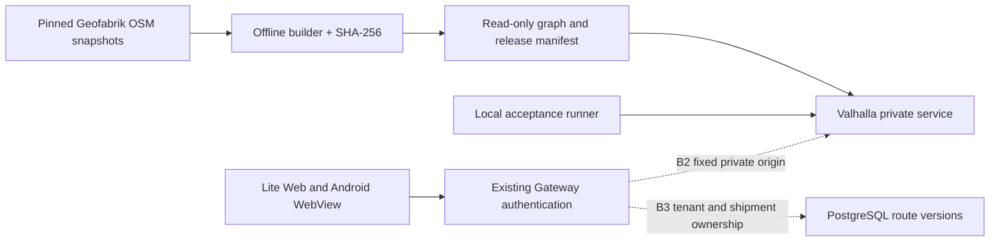

# ADR · Valhalla Foundation (Issue #88 B1)

## Decision and existing contracts

Use Valhalla 3.6.3 in an independent private container. Build a read-only, replaceable graph from pinned OSM extracts. Gateway remains the sole future application interface for routing. B1 contains the graph builder, service configuration and real-engine acceptance. B2 adds authenticated calculation and B3 adds PostgreSQL versioning.

The current Gateway uses scoped actor identities, tenant-qualified queries and CSRF for browser writes. Lite Android uses the existing HTTPS WebView session. Native endpoints have a separate session audience. Cargo owns shipment scopes and transitions. In PostgreSQL, checkpoint rows bind tenant, shipment and observation provenance. Device registry, AOVX ingestion and receipt/measurement timestamps form a separate observation contract. The Leaflet renderer preserves the camera during polling and draws planned stops independently of eligible device fixes.

Keep three contracts distinct:

- Planned checkpoints remain authoritative for shipment milestones and current Cargo behavior.
- Calculated route geometry and maneuvers are predictions attached to a graph release and vehicle profile.
- Observed GPS points retain device and measurement provenance. A road snap never creates a physical observation.

B1 adds no Gateway endpoint, migration, UI, APK or Core change. B2 will reuse scoped authorization, sessions and CSRF. B3 should version proposed, approved and active geometry independently of checkpoints and reuse the composite tenant ownership boundary.

[Cargo API](../services/gateway/src/cargo/api.js) · [Browser pairing and CSRF](../services/gateway/src/cargo/pairing.js) · [Shipment/checkpoint keys](../services/gateway/migrations/002_cargo.sql) · [Road basemap ADR](ADR_LITE_ROAD_MAP.md) · [Coverage review](LITE_ROAD_EUROPE_REVIEW.md)



Clients have no access to the Valhalla network or hostname. Compose uses an internal network without a published port. The service runs with a numeric non-root identity, capabilities dropped, and writes limited to an ephemeral scratch mount. The graph builder has no network. Runtime enables only route and status, with at most 12 locations and 3,000 km for supported profiles. The service timeout is 30 seconds. Compose declares two CPUs, two workers, a 4 GiB memory budget and 96 PID limit. Verify enforcement on the deployment host's cgroup configuration. Health validates the expected engine and a readable graph tile over local HTTP.

## Reproduce

1. Install Python 3.11+ and Docker Compose. For combined pilot preprocessing use Osmium 1.18.0. Choose a container UID/GID that owns the inputs and graph files, subject to the local daemon's mapping. The builder accepts `--container-user UID:GID` and runtime accepts `VALHALLA_RUN_AS`.
2. Copy the [Ukraine manifest](../routing/valhalla/sources/ukraine.json) or [corridor recipe](../routing/valhalla/sources/sources.json) next to the PBFs. Use the exact downloaded snapshots and validate SHA-256 and size. Geofabrik can rotate dated exports. Reproduce from an archived byte-identical PBF when a dated URL expires.
3. The Ukraine release uses its entire Geofabrik extract. The corridor release crops only declared bounding windows, retains highways/ferries and restriction/connectivity relations with available references, merges by OSM object identity and selects the latest visible version at the cutoff. Cropped boundaries can remove alternative paths. The route probe, rather than polygon overlap, verifies cross-border connectivity.
4. Compile into a fresh empty directory. The builder publishes config, metrics and a manifest after a successful build. SHA-256 of sorted tile names and contents identifies the graph material. The release ID also binds source and configuration. Archive graph and manifests. Source OSM is ODbL. Retain attribution and satisfy derivative database obligations for any redistribution.

```sh
python3 routing/valhalla/build-graph.py /path/to/inputs/ukraine.json /path/to/graph-ukraine
python3 routing/valhalla/prepare-corridors.py /path/to/inputs/sources.json /path/to/prepared
python3 routing/valhalla/build-graph.py /path/to/prepared/corridors.json /path/to/graph-corridors
export VALHALLA_GRAPH_DIR=/path/to/graph-corridors
export VALHALLA_RUN_AS="$(id -u):$(id -g)"
docker compose -f routing/valhalla/compose.yaml up -d --wait --wait-timeout 120
docker compose -f routing/valhalla/compose.yaml exec -T valhalla python3 - corridors \
  < routing/valhalla/probe.py
docker compose -f routing/valhalla/compose.yaml down
```

Use probe mode `ukraine` with the Ukraine graph. The probe checks geometry, legs and instruction-bearing maneuvers and records HTTP results, errors, duration and distance. CI uses an explicitly synthetic restriction fixture with the same binary and network boundary.

## Operating and safety boundaries

- Build candidates in isolation. Verify source and tile hashes, route canaries, health, HGV costing and resource usage before selecting a candidate. Keep the prior graph and matching config. For a rollback, point `VALHALLA_GRAPH_DIR` at that release, recreate the service and rerun canaries. In B2 every result should carry its graph ID. Keep historical route IDs stable.
- Travel times are static model estimates. The pilot omits administrative and timezone databases, live traffic, border queues, elevation supplements and real-time closures. Conditional access needs separate verification. An OSM path cannot establish wartime availability, current checkpoints, bridge access or legality. For expanded builds, include verified admin/timezone data and test conditional restrictions against independent sources.
- Valhalla 3.6.3 truck costing accepts height, width and length in meters and weight and axle load in metric tonnes. The fixture varies each parameter independently against the corresponding OSM tag. B2 must validate dimensions, preserve profile and forbid silent car fallback. Missing HGV or conditional tags do not establish clearance. [Pinned costing code](https://github.com/valhalla/valhalla/blob/3.6.3/src/sif/truckcost.cc)
- Monitor readiness, tile-load errors, request timeouts, no-path rate, CPU, memory and latency without logging user coordinates. B2 must limit input and upstream response bytes, enforce actor/tenant quotas and concurrency, restrict calls to the fixed private upstream without redirects, and return normalized errors. Version source metadata with the actual graph.

## Full coverage plan

Keep the full input coverage of the Ukrainian extract and sample graph routability by oblast, rural/secondary roads and small towns. Before expansion validate source boundaries, authorised crossing policy, and admin/timezone data. Use one connected European extract containing the required Ukrainian coverage, or merge aligned PBFs by object identity before a single graph compilation. Independent Valhalla tile sets cannot be concatenated by country. Rerun the six requested corridors, test additional crossings and profile-specific no-path cases, and measure cost and service capacity before promotion.

The published Europe PBF was 35.54 GB at the Stage A review. Two input copies alone need about 71 GB before temporary files, graph and rollback. This machine lacks that safe headroom. An expanded build needs separately budgeted scratch and a larger offline builder. Derive requirements from observed compilation runs, repeat with the chosen Europe snapshot and benchmark cold/warm concurrent workloads. Production resources and spend remain operator decisions.

B2 follows with a bounded, tenant-aware Gateway adapter using the current Lite WebView session and same-origin API. Validate polyline6, lengths, durations and maneuver limits and return graph provenance. B3 adds immutable revisions, audited transitions and optimistic concurrency. Fleet Map V2, Android GPS and navigation remain later stages. Core retains its independent authentication, proof engine and data.

[Measured graph sizes, timings, route and fixture evidence](valhalla-b1/README.md).
