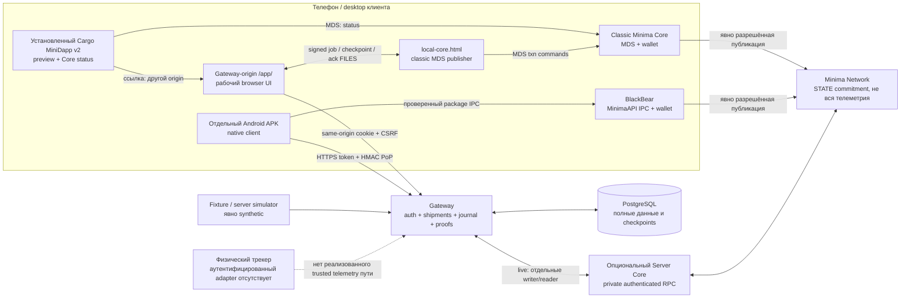
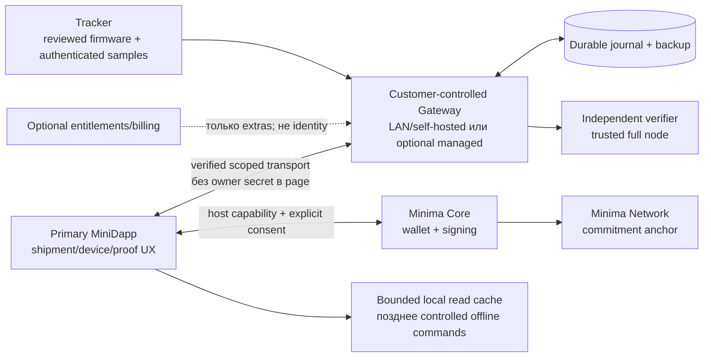

# Trackium: аудит децентрализованной архитектуры

**Срез:** `main`, [`196b3dd5848e35844acfeffccf8f984030d7bee3`](https://github.com/themightydanik/trackium/tree/196b3dd5848e35844acfeffccf8f984030d7bee3), 2026-11-08. **Изменения аудита:** только этот документ и [дорожная карта](DECENTRALIZED_ROADMAP.md). Runtime, Railway settings, API, SQL и приложения не изменялись. Реальные blockchain-транзакции не выполнялись.

## 1. Вывод

Trackium сейчас — защищённая **Gateway/PostgreSQL foundation с несколькими клиентами**, а не завершённый Minima-native продукт по сценарию «купить трекер → открыть MiniDapp → безопасно привязать → работать». Существуют полезные tenant APIs, shipment state machine, synthetic ingestion, два механизма клиентских сессий и тщательно ограниченная публикация commitments. Но основной установленный MiniDapp **не подключён к этому рабочему контуру**, а криптографическая идентичность физического трекера и приём его реальной телеметрии отсутствуют. Это следует из [инициализации клиента без transport](../assets/v2/cargo.js), [`GatewayClient.read`](../assets/v2/gateway-client.js), [same-origin server client](../assets/v2/server-client.js), [`register`/`ingestFixture`](../services/gateway/src/telemetry/service.js) и [synthetic-only SQL](../services/gateway/migrations/001_telemetry.sql).

Проект **не требует email на уровне протокола**: tenant и ключи создаются operator CLI, а не внешней регистрацией. Но отсутствие email не означает пользовательскую идентичность Minima или самостоятельную активацию устройства: сейчас клиенту нужен tenant UUID и отдельное одобрение владельца Gateway. [CLI](../services/gateway/src/telemetry/admin.js), [`issueKey`/`provisionTenant`](../services/gateway/src/telemetry/service.js), [`createNativeSessions`](../services/gateway/src/cargo/native-session.js).

Кратчайший безопасный путь — сохранить Gateway как доступный self-hosted приёмник и координатор, сделать MiniDapp основным интерфейсом к существующему доменному ядру, отдельно закрыть аппаратную аутентификацию и добавить проверенный Core-origin transport. Переписывать работающие миграции, вводить обязательный SaaS login или удалять Gateway не требуется. Перед этим надо изолировать небезопасный legacy wallet path; это первый предлагаемый implementation PR в [P0.1 дорожной карты](DECENTRALIZED_ROADMAP.md#p01--изолировать-legacy-wallet-path).

## 2. Метод и границы доказательств

Используются четыре обозначения: **код** — путь существует в исходниках; **локально проверено** — существующий test исполнился в этом аудите; **наблюдение Railway** — конкретный публичный read-only ответ; **проектируется** — предложения, которых ещё нет. Тест с mock Core не подтверждает реальное подписание, Android IPC или inclusion в Minima.

В этом аудите прошли без skipped/failed:

| Проверка | Результат и граница |
| --- | --- |
| `npm test` в `services/gateway` | 51 тест: framing/lifecycle, validation, proof safety, RPC mock, legacy MDS mock, Railway guard. [Тесты](../services/gateway/test) |
| `npm run test:integration` | 37 тестов на отдельном локальном PostgreSQL 16, изолированные схемы: SQL 001–005, scopes/tenant isolation, synthetic pipeline, browser/native sessions, proof state/recovery с mock nodes. [Native](../services/gateway/test/native.integration.js), [proofs](../services/gateway/test/proofs.integration.js), [local publisher](../services/gateway/test/local-publisher.integration.js), [Railway process](../services/gateway/test/railway.integration.js) |
| MiniDapp `core.test.cjs` + `browser.test.cjs` | 16 тестов; Chromium, static/demo UX и bundled MDS SDK с подставными node responses. [Core](../tests/minidapp/core.test.cjs), [browser](../tests/minidapp/browser.test.cjs) |
| `tests/minidapp/server.integration.cjs` | 1 browser → local Gateway → PostgreSQL → synthetic shipment/history сценарий; не физический трекер. [Сценарий](../tests/minidapp/server.integration.cjs) |
| Vendored SDK | SHA-256 пяти Java-файлов совпали с [SOURCE.json](../apps/android/minimaapi/SOURCE.json); это целостность vendored source, не подтверждение поведения установленного APK |

Итого 105 локальных тестов. JVM/Gradle Android suite, APK install, физический tracker, реальный Core, load/restore/penetration tests в этом аудите **не запускались**. Android [PublisherTest](../apps/android/app/src/test/java/tech/trackium/cargo/PublisherTest.kt) и [NodeRoutingTest](../apps/android/minimaapi/src/test/java/com/eurobuddha/minimaapi/NodeRoutingTest.java) изучены как mock coverage, их исторический успех не засчитан как новый запуск.

### Наблюдение опубликованного Railway

Адрес предоставлен владельцем: `https://trackium-gateway-production.up.railway.app`. 2026-11-08 **15:51 Europe/Kyiv** выполнены только пять обычных HTTPS GET, без токенов, cookies, POST/DELETE, owner provisioning, сканирования или изменения settings:

| Путь | Наблюдение |
| --- | --- |
| `/healthz` | 200, JSON `status=ok`, `service=trackium-gateway`, `mode=raw-capture-only` |
| `/readyz` | 200, тот же health envelope |
| `/app/` | 404; workspace через этот URL не доступен на момент наблюдения |
| `/v1/devices` | 401 без авторизации |
| `/v1/shipments` | 401 без авторизации |

Это подтверждает доступность указанного HTTPS HTTP-сервиса и отказ двух анонимных read-запросов. По [реализации health](../services/gateway/src/gateway.js) readiness после startup делает `SELECT 1`; **если развёрнут этот код**, ответ согласуется с доступной БД. `mode=raw-capture-only` там задан литералом и **не доказывает** фактический PROOF_MODE/набор включённых APIs. 404 согласуется с выключенным workspace, но его причина не установлена. Deployed SHA, версии/checksums миграций, private DB topology, replica count, переменные, backups, native pairing и authenticated tenant isolation на Railway **не проверены**. Имя `production` в domain не является оценкой production readiness. Репозиторный [Railway профиль](../.railway/railway.ts) — desired configuration, не снимок реальных settings. Нельзя включать `/app/` ради аудита без отдельного решения оператора.

## 3. Фактические компоненты и потоки

Связь файлами `W↔L` не означает автоматический HTTP bridge. У native APK job/checkpoint/result передаются HTTPS через Gateway. У Railway test profile proof engine и raw TCP отключены; это показанные **опциональные кодовые пути**, не подтверждение их включения на публичном адресе. [Runtime wiring](../services/gateway/src/cargo/runtime.js), [local exchange](../assets/v2/local-core-page.js), [native Gateway](../apps/android/app/src/main/java/tech/trackium/cargo/NativeGateway.kt), [test profile](../services/gateway/src/config.js).

Существует ещё отдельный legacy контур: `legacy.html → assets/js/* → MDS SQL/wallet`, а `service.js` опрашивает `127.0.0.1:8123/location` и пишет локальные `devices/movements/events`. Он не кормит Cargo PostgreSQL pipeline. Сервис передаёт в pull функцию device ID, но URL один и тот же; ответный `data.deviceId` не является криптографическим доказательством связи с выбранным трекером. Это незавершённая companion-интеграция, не аппаратный authenticated adapter. [Service](../service.js), [ES5 schema](../assets/v2/background-database.js).

## 4. Матрица соответствия продуктовому сценарию

| Функция | Фактический статус | Доказательство / ограничение |
| --- | --- | --- |
| Установить MiniDapp | Код упаковки есть | [Packager](../scripts/package-minidapp.py) включает index/local-core/legacy/service и assets. Установка реального пакета на Core здесь не проверена |
| Cargo внутри classic Core | Частично | [`TrackiumMDS.start`](../assets/v2/mds-bridge.js) проверяет реальный callback `status`; [`new GatewayClient()`](../assets/v2/cargo.js) не получает session transport. Preview не становится рабочим Gateway workspace |
| MiniDapp в BlackBear | Нет поддержанного пути в текущей интеграции | [`jobCheck`](../assets/v2/local-core.js) отвергает `android_minimaapi`; используется отдельный [APK](../apps/android/app/src/main/java/tech/trackium/cargo/TrackiumApp.kt), не MDS MiniDapp |
| Android + desktop | Разные частичные клиенты | Classic MDS/file workflow отдельно от Android IPC/HTTPS. Оба mock-tested; реальная совместимость desktop/Android WebView/Core требует acceptance |
| Создать shipment | Backend и Gateway UI реализованы | [`create`](../services/gateway/src/cargo/shipments.js), [`createForm`](../assets/v2/server-workspace.js), submit handler в [cargo.js](../assets/v2/cargo.js); это не Core-origin работа |
| Редактировать shipment | Частично | `update`/PATCH меняет только draft, пишет `shipment_updated`; UI имеет create/transitions, но не полноценную edit-форму. [Service](../services/gateway/src/cargo/shipments.js), [API](../services/gateway/src/cargo/api.js) |
| Маршрут / условия / события | Реализовано для текущего pipeline | `routeAndConditions`, `onTelemetry`, checkpoints, route/temperature violation; [cargo integration](../services/gateway/test/cargo.integration.js). Карта — schematic, не внешний tracking/navigation service |
| Реальный tracker tracking | Отсутствует завершённая интеграция | TCP — LF raw journal без GL110-GL parser/ACK/device authentication. Нормализованные события приходят только через `ingestSynthetic`; [framer](../services/gateway/src/framing.js), [journal](../services/gateway/src/journal.js), [ingestion](../services/gateway/src/cargo/ingestion.js) |
| Регистрация устройства | Registry CRUD частично | `register` создаёт tenant-local UUID и binding. `mode=real` означает registry label/`physical`, а не проверенное владение. Нет manufacturing key, activation или transfer API. [Telemetry service](../services/gateway/src/telemetry/service.js) |
| Native pairing | Реализовано для клиента | Owner approval + random proof → short-lived HMAC session; не challenge физического трекера. [Native service](../services/gateway/src/cargo/native-session.js), [native tests](../services/gateway/test/native.integration.js) |
| Просмотр proofs | В Gateway и APK реализован, в static MiniDapp placeholder | [Server view](../assets/v2/server-workspace.js), [Android refresh](../apps/android/app/src/main/java/tech/trackium/cargo/TrackiumApp.kt), [`proofsPage`](../assets/v2/cargo.js). В текущем Railway `/app/` не доступен |
| Ручной дополнительный proof | Частично | Owner CLI может approve **существующее выбранное событие**; local publisher требует signed job. Нет общего MiniDapp action «создать произвольный snapshot proof». [Ownership](../services/gateway/src/proofs/ownership.js), [CLI](../services/gateway/src/proofs/admin.js) |
| Автоматические blockchain proofs | Ограничено намеренно | Test worker автоматически делает только test receipts; live tick работает с явно approved jobs, без автоматического backlog approval. [Proof tick](../services/gateway/src/proofs/service.js) |
| Offline basic operation | Не реализовано полноценно | Static preview и legacy local data могут открываться на доступном Core; live data очищаются при ошибке. Нет Cargo offline journal/write queue/sync. [`clear`/`refresh`](../assets/v2/server-client.js), [AppController.task](../apps/android/app/src/main/java/tech/trackium/cargo/TrackiumApp.kt) |
| Компания / сотрудники / восстановление | Foundation, не готовый workflow | Tenant и несколько scoped keys есть; нет employee membership, per-shipment ACL, device transfer или безопасного recovery UI. [SQL 001](../services/gateway/migrations/001_telemetry.sql), [service](../services/gateway/src/telemetry/service.js), [SecureStore](../apps/android/app/src/main/java/tech/trackium/cargo/SecureStore.kt) |
| Без email / бесплатная основа | Email не нужен; commercial entitlement отсутствует | Нет email/login/payment tables в текущих миграциях; bootstrap через CLI. Self-host требует ресурсов/оператора; покупка устройства не доказывает бессрочную бесплатность hosted инфраструктуры |

Нельзя суммировать возможность `/app/` и наличие MDS SDK в `index.html` как «всё уже работает в MiniDapp»: [`TrackiumServer.enabled`](../assets/v2/server-client.js) включён только для `/app/`, а MDS bridge на этом пути специально не запускает Core session. В [foundation documentation](MINIDAPP_V2_FOUNDATION.md) есть ранние «не реализовано», которые описывают старый baseline; текущее состояние определяется кодом, не этими фразами.

## 5. Gateway: что необходимо, что переносимо

| Компонент | Зачем нужен сейчас | Перенос / безопасное упрощение |
| --- | --- | --- |
| Public telemetry receiver / adapter | Доступный endpoint для cellular/IP tracker; raw journaling отдельно от trusted events | Оставить customer-controlled Gateway. Перенос на телефон возможен только при подтверждённом BLE/local transport, фоновой работе и доступности устройства; таких возможностей трекера код не доказывает. Не открывать текущий raw TCP наружу. [Gateway lifecycle](../services/gateway/src/gateway.js) |
| PostgreSQL journal / event chain / outbox | Транзакции, tenant FKs, сериализация, durable checkpoints | Пока сохранить. MDS SQL не выполняет PostgreSQL migrations и не является distributed storage. Позже локальный read cache/контролируемая replica, не второй независимый writable источник. [SQL](../services/gateway/migrations/002_cargo.sql), [`tenantLock`](../services/gateway/src/cargo/shared.js) |
| Shipment validation / event derivation | Одни правила route/conditions, события и дедупликация | Выделять portable pure domain logic и повторно использовать с адаптерами, а не переписывать на Kotlin/JS/SQL отдельно. Не переносить Node/pg service целиком в Rhino. [`routeAndConditions`/`onTelemetry`](../services/gateway/src/cargo/shipments.js) |
| UI / maps / forms | Не требуют работы на серверном origin по смыслу продукта | Перенести основной UX в MiniDapp, сохранив authenticated transport. `/app/` оставить вторичным operator/support client; не выдавать его ссылку за завершённый Core handoff. [UI](../assets/v2/server-workspace.js) |
| Session auth / tenant ACL | Фактическая граница компаний и выдачи scopes | Сохранить contracts, mapped tenant IDs и revocation; позднее привязать проверенную Minima identity к существующему tenant, без обязательного email. UID/address сами по себе не identity proof. [Pairing](../services/gateway/src/cargo/pairing.js), [native](../services/gateway/src/cargo/native-session.js) |
| Private wallet / signing | Секреты и подпись должны оставаться в клиентском Core для базового сценария | Server Core publisher оставить opt-in advanced deployment. Нельзя переносить wallet seed в Gateway или браузер. [Minima adapter](../services/gateway/src/proofs/minima.js), [native publisher](../apps/android/app/src/main/java/tech/trackium/cargo/NativePublisher.kt) |
| Approval / checkpoint coordinator | Защищает от двойной траты и неопределённого исхода операции между устройствами | Сохранить job/ack/claims до появления эквивалентного durable coordinator. Убрать ручной перенос файлов можно лишь после проверки нового transport; удаление checkpoint-before-post ради UX недопустимо. [Ownership.job/checkpoint/result](../services/gateway/src/proofs/ownership.js) |
| Independent proof verification | Chain inclusion/depth/reorg observation доверенного full node | Можно запускать на другом доверенном узле клиента через export/verify-cli; сохранить возможность независимой проверки. Это не trustless JS consensus. [Verifier](../services/gateway/src/proofs/verifier.js), [CLI](../services/gateway/src/proofs/verify-cli.js) |
| Simulator / fixture / static preview | Проверки и демонстрация, не основа trusted telemetry | Сохранить в test/demo boundaries, убрать из обязательного onboarding. Не объединять источники и не повышать trust по наличию hash. [Ingestion](../services/gateway/src/cargo/ingestion.js), [demo](../assets/v2/demo-data.js) |

## 6. Безопасность и идентификация

### Что уже полезно и должно сохраниться

- API service queries фильтруют `tenant_id`; composite FKs связывают device/event/shipment с tenant. [`createTelemetryApi`](../services/gateway/src/telemetry/api.js), [`createCargoApi`](../services/gateway/src/cargo/api.js), [SQL 001–002](../services/gateway/migrations/002_cargo.sql). PostgreSQL RLS здесь не объявлен: application filters и constraints не защищают от компрометации DB-role/operator. Локальные [tenant tests](../services/gateway/test/telemetry.integration.js) не доказывают внешний pentest Railway.
- Owner tokens случайные, в БД хранится SHA-256, выдача — [operator-only CLI](../services/gateway/src/telemetry/admin.js) в новый `0600` файл вне checkout. Bootstrap key имеет широкие scopes, поэтому его нужно заменить ограниченными credentials и отозвать, как описано в [deployment guide](RAILWAY_DEPLOYMENT.md). Это не Minima wallet identity.
- Browser session ограничена audience, owner scopes, сроком, same-origin cookie и CSRF; native session требует proof possession, timestamp/nonce, не принимает browser cookies/Origin, наследует revocation approving owner. [Pairing](../services/gateway/src/cargo/pairing.js), [native](../services/gateway/src/cargo/native-session.js), [migration 005](../services/gateway/migrations/005_native_android.sql).
- Railway-test guard проверяет точный Host/Origin, не выводит identity из forwarded headers и ограничивает запросы; включение этого guard зависит от profile, а не самого факта хостинга Railway. [Ingress](../services/gateway/src/ingress.js), [config](../services/gateway/src/config.js). Отсутствие внешних admin provisioning endpoints не отменяет существующих tenant-scoped admin API с проверкой scopes.

### P0: legacy wallet path не является безопасным fallback

[`legacy.html`](../legacy.html) включает внешний Leaflet JS без SRI; [`dapp.conf`](../dapp.conf) сохраняет `trust: write`; [packager](../scripts/package-minidapp.py) включает legacy assets. [`onMDSReady`](../assets/js/app.js) запускает `blockchain.init`, который вызывает `newscript`. [`submitProofOfMovement`](../assets/js/blockchain.js) использует float-расчёты, output на contract/node address, вычитает `0.0001`, вызывает `txnpost` и принимает `postResult.txpowid || txnId` как «TXID». Там также существует `startAutoProofSubmission`; факт наличия метода **не доказывает**, что таймер запущен по умолчанию.

Это отличающийся от нового self-transfer/zero-burn/job-approval протокол без его инвариантов. Новый `PROOF_MODE=disabled` ограничивает Gateway, но **не эти независимые MDS-команды**. Доступен путь из v2 через [`legacyUrl`](../assets/v2/mds-bridge.js). Это статически установленная опасная поверхность, а не доказательство эксплуатации или уже совершённого перевода. Внешний script в privileged page усиливает supply-chain риск. Первый remediation PR должен изолировать legacy wallet actions и внешние scripts, сохранив чтение/экспорт старых данных; не «узаконить» старые proof flags в новом engine.

### Три разные идентичности, которых нельзя смешивать

1. **Gateway client:** native proof генерируется APK и доказывает владение его random secret. Это не подпись аппаратного Trackium device и не доказательство Minima identity. [`NativeGateway.challenge`](../apps/android/app/src/main/java/tech/trackium/cargo/NativeGateway.kt).
2. **Minima user/company:** сейчас owner = случайный Gateway bearer key. MDS UID определяет Core app/session context, публичный address — публичное значение; они не аутентифицируют удалённого владельца tenant. [MDS bridge](../assets/v2/mds-bridge.js), [owner auth](../services/gateway/src/telemetry/service.js).
3. **Физический tracker:** `telemetry_device_bindings` — строка о tenant-local UUID. `register` не требует hardware key/certificate/IMEI proof. Один физический tracker нельзя надёжно обнаружить как дважды зарегистрированный в разных tenants: globally authenticated hardware identity ещё нет. [Registry](../services/gateway/src/telemetry/service.js), [bindings SQL](../services/gateway/migrations/001_telemetry.sql).

Не обнаружены в активном Cargo pipeline: manufacturing trust root, одноразовая активация физического устройства, handshake с ним, ownership epoch, transfer/revoke previous owner, factory reset policy, безопасное lost-owner recovery. Это перечень отсутствующих контрактов в текущих [routes](../services/gateway/src/cargo/api.js), [telemetry routes](../services/gateway/src/telemetry/api.js) и migrations, а не утверждение о возможностях ещё не изученной прошивки. До firmware/spec review нельзя обещать аппаратную подпись или выбирать BLE/Maxima как готовый transport.

Legacy [`DeviceRegistry.findDeviceRegistration`](../assets/js/device-registry.js) читает локальный cache и возвращает null без него; реальный on-chain lookup и Maxima subscription помечены TODO. Password hash в STATE и local `blockchainProof=true` не доказывают аппаратное владение, не решают transfer/recovery и не должны стать identity foundation.

Несколько устройств в одном tenant поддержаны registry и shipment FK. Несколько сотрудников могут получить отдельные keys/sessions, но scopes действуют на tenant целиком; нет именованных memberships, per-device/per-shipment grants или человеческого audit actor. Native session имеет только `read,publish`, поэтому не покрывает shipment write UX даже если добавить кнопку в APK. [Key scopes](../services/gateway/src/telemetry/service.js), [native authenticate](../services/gateway/src/cargo/native-session.js), [route scopes](../services/gateway/src/cargo/api.js).

## 7. Что реально доступно через Minima API

| Поверхность | Подтверждённое | Чего нельзя предполагать |
| --- | --- | --- |
| Bundled classic MDS | `cmd`, `sql`, `api`, `net.GET`, Basic `GETAUTH`, `net.POST`, `keypair.get/set`; [mds.js](../mds.js). Bridge использует только `status` | `MDS.net` здесь не имеет произвольного Bearer/PoP-header API; `GETAUTH` — не Bearer. `MDS.api` сам по себе не доказывает безопасный broker/caller binding |
| MDS `keypair` | App-scoped persistent key/value strings | Это **не** генератор криптографических пар и не доказанная изоляция secrets от JS того же MiniDapp; [upstream KEYPAIRcommand](https://github.com/minima-global/Minima/blob/52542f25605a28a776e9b3b43b0808a05dceab01/src/org/minima/system/mds/handler/KEYPAIRcommand.java). Хранить там long-lived owner credential нельзя считать безопасным решением |
| Classic Core 1.0.49.4 | [upstream `sign`](https://github.com/minima-global/Minima/blob/52542f25605a28a776e9b3b43b0808a05dceab01/src/org/minima/system/commands/signatures/sign.java) подписывает HEX data через wallet; [`verify`](https://github.com/minima-global/Minima/blob/52542f25605a28a776e9b3b43b0808a05dceab01/src/org/minima/system/commands/signatures/verify.java) проверяет root public key/signature | В текущих Trackium RPC/native allowlists `sign`/`verify` не доступны как login feature. Отсутствие HTTP endpoint нельзя заменить предположением, что произвольный challenge уже можно подписать |
| Wallet key uses | [`Wallet.signData`](https://github.com/minima-global/Minima/blob/52542f25605a28a776e9b3b43b0808a05dceab01/src/org/minima/database/wallet/Wallet.java) синхронизирован, использует/persist-ит счётчик TreeKey | Подпись login challenge расходует key uses; не подписывать каждый polling request wallet key, не копировать seed/счётчики для identity sync. Возможность этой схемы на реальном BlackBear требует отдельной проверки |
| BlackBear 2.2.10 profile | [Native transport](../apps/android/app/src/main/java/tech/trackium/cargo/BlackBearTransport.kt) использует public [MinimaAPI.Command](../apps/android/minimaapi/src/main/java/com/eurobuddha/minimaapi/MinimaAPI.java), фиксирует package/APK hash/cert/version и foreground/admin gates | IPC требует Android process; JavaScript MiniDapp не становится IPC client от наличия SDK в APK. Поддержанного BlackBear MDS host в текущем Trackium пути нет; нельзя обещать один MiniDapp на нём без host capability work |
| Classic Local Core publisher | `MDS.cmd` fixed transaction flow, WebCrypto P-256, BigInt, Web Locks, persistence; [adapter](../assets/v2/local-core.js) | Не работает без этих capabilities; mock Android-like MDS не проверяет конкретный WebView/Rhino/Core. Background initializer ES5 не означает, что весь foreground publisher ES5-compatible |

Для classic commands ограничения READ/WRITE проверены в [upstream CommandRunner](https://github.com/minima-global/Minima/blob/52542f25605a28a776e9b3b43b0808a05dceab01/src/org/minima/system/commands/CommandRunner.java) и отражены в [MDS READ tests](../services/gateway/test/local-core.test.js): не все custom-transaction mutations классифицированы WRITE. Уже существующее [предупреждение BlackBear/shared transaction namespace](ANDROID_MINIMA_CORE.md#essential-wallet-trust-boundary) надо сохранять: Trackium checks/locks не создают атомарную per-app изоляцию внутри Core. Полный исходник исполняемого BlackBear engine/IPC и физический hostile-app race в этом аудите заново не аттестованы; это унаследованный, не снятый риск. Dedicated wallet и trusted enabled apps — временные prerequisites, не исправление host isolation.

Таким образом, Minima identity без email **возможна как направление**, но ещё не готовый протокол Trackium. Нужны versioned domain-separated challenge, nonce/audience/expiry, проверка владения выбранным key, caller binding, привязка к существующему tenant, delegation/revocation/recovery и оценка key-use budget. Это работа последующих PR, не новая система авторизации, добавленная данным аудитом.

## 8. Blockchain Proof Engine: возможности и границы

### Данные и доверие

[`appendEvent`](../services/gateway/src/cargo/shipments.js) создаёт canonical event с tenant/shipment/device ID, sequence, event_time, source_trust, previous_hash и data; atomic outbox входит в ту же транзакцию. [SQL trigger](../services/gateway/migrations/002_cargo.sql) запрещает обычный UPDATE/DELETE cargo events; [proof trigger](../services/gateway/migrations/003_proofs.sql) фиксирует identity и артефакты. Это защита прикладного пути/ошибок, не защита от DB superuser, который способен изменить triggers/данные до anchoring.

[`buildCommitment`](../services/gateway/src/proofs/commitment.js) доменно разделяет envelope, использует SHA-256 и STATE port 250: magic/version/flags + digest. **На цепь не записывается вся история и GPS**; это публичный якорь к сохранённому off-chain payload. Prefix chain в bundle позволяет проверить связность предоставленной истории до события, не отсутствие последующих/скрытых событий и не истинность показаний. `synthetic`/`unverified` не превращается в physical attestation. Bundle содержит чувствительные cargo/route/tenant данные, хотя STATE — только digest; [bundle/export limits](../services/gateway/src/proofs/service.js), [verification](../services/gateway/src/proofs/verifier.js).

### Автоматическое и ручное

События derive-ятся автоматически из synthetic telemetry (`onTelemetry`); test mode автоматически выдаёт локальные receipts **без TXID**. Live `tick` не делает backlog approval: owner должен выбрать существующий event и точную фразу `PUBLISH MAINNET <UUID>`. Набор `TYPES` включает семь event classes, но не `telemetry_recorded`/`shipment_updated`; эти промежуточные записи входят в chain prefix. [Types](../services/gateway/src/proofs/commitment.js), [`approve`](../services/gateway/src/proofs/ownership.js), [test receipt tests](../services/gateway/test/proofs.integration.js).

Approve принимает только confirmation, извлекает event через tenant-scoped DB query и строит commitment из сохранённых canonical bytes. Пользователь не передаёт replacement telemetry в approval. Job signature/chain/state/witness/spend checks и immutable checkpoint защищают выбранное событие от подмены по этому пути. [Ownership](../services/gateway/src/proofs/ownership.js), [local validation](../assets/v2/local-core.js), [native protocol](../apps/android/app/src/main/java/tech/trackium/cargo/ProofProtocol.kt). При этом владелец с shipment-write правом может создать свои business assertions или synthetic data: наличие ручного proof не делает их показаниями физического сенсора.

`PROOF_MAX_PUBLICATIONS=1` — защитный default и жёсткое условие Railway test profile, **не тариф и не одна публикация на каждое устройство**. `approve` считает все live proof rows по всему Gateway и по tenant policy; это lifetime reservation budget, включая неудачные/незавершённые jobs. Поэтому второй ручной proof и независимые компании не становятся автоматически доступными после первого. Server policies также требуют единственный configured publisher address; local policies могут выбирать собственный wallet, но общий budget и coordinator остаются общими. [Approve/policy](../services/gateway/src/proofs/ownership.js), [config](../services/gateway/src/config.js). Для многокомпанейного managed режима нужны отдельные reviewed quotas/authority/операционные границы, а не снятие лимита или удаление старых rows.

Общий пользовательский action «сделать дополнительный proof сейчас» отсутствует. Будущий action должен выбирать immutable event или создавать **отдельное явно обозначенное пользовательское утверждение/snapshot** с bounded input и unique request ID, не редактировать telemetry и не выдавать утверждение оператора за sensor-signed sample. Сначала требуется контракт и negative tests; не просто вызвать legacy submit.

### Подпись, ресурсы и retry

Server mode подписывает приватным writer Core; local classic и native — в пользовательском Core. Local jobs подписаны отдельным Gateway P-256 issuer, это не Minima user/device identity. Native использует Keystore AES-GCM/noBackupFilesDir, foreground consent, durable этапы и bounded retries; [SecureStore](../apps/android/app/src/main/java/tech/trackium/cargo/SecureStore.kt), [NativePublisher.run](../apps/android/app/src/main/java/tech/trackium/cargo/NativePublisher.kt). Private wallet keys не передаются в Gateway.

Новый протокол запрашивает **0.001 MIN self-transfer и burn 0**, проверяет input/output address/token, conservation, input cap и exact 44-place arithmetic; сумма возвращается владельцу, не является платой Trackium. Нельзя обещать «blockchain ничего не стоит»: требуются spendable coins, временная блокировка выбранных inputs, PoW/устройство/сеть и key uses. Реальная применимость параметров/политик сети здесь не измерена. [checkSpend/preflight](../services/gateway/src/proofs/safety.js), [checkTransaction/createMinima](../services/gateway/src/proofs/minima.js). Legacy имеет другой burn path и сюда не относится.

Уникальность `(event_id,mode)`, deterministic custom ID, signed/mined artifact persistence, advisory lock, wallet claim и checkpoint **до** post уменьшают риск повторной финансовой операции. После неизвестного исхода следует reconcile известный ID и повторять только тот же blob; timeout не означает отмену. [Proof tick](../services/gateway/src/proofs/service.js), [claims](../services/gateway/migrations/004_publisher_safety.sql), [local recovery tests](../services/gateway/test/local-publisher.integration.js), [native lost-reply mock tests](../apps/android/app/src/test/java/tech/trackium/cargo/PublisherTest.kt).

Это не универсальная exactly-once гарантия: Core crash/backup rollback, lost local artifacts, несколько wallet copies, чужой enabled app или независимый Gateway с тем же wallet выходят за пределы одной DB reservation. Stalled approved job удерживает slot; нельзя удалять записи/сбрасывать квоты ради «повтора». Одобрение имеет TTL 24 h, claims могут пережить закрытие клиента; нужен явный recovery процесс. [`job/checkpoint/result`](../services/gateway/src/proofs/ownership.js).

### Проверка

[`inspectChain`](../services/gateway/src/proofs/verifier.js) проверяет транзакцию, commitment, сеть, inclusion block, consistent tip и depth на отдельно настроенном full node; reorg/pruning/unavailable не считаются подтверждением. Есть [отдельный verify CLI](../services/gateway/src/proofs/verify-cli.js), но JS не реализует consensus/SPV. Выбор ожидаемого publisher/сети verifier-ом — часть trust policy. Cached state `confirmed` не заменяет свежую независимую проверку. [Negative tests](../services/gateway/test/proofs.test.js).

Ограничения: bundle ≤4 MiB, chain prefix ≤2000 records, fixed verifier work limits; автоматической segmented verification нет. Следовательно, длинный shipment может перестать экспортироваться целиком раньше, чем сеть Minima перестанет принимать якоря. Это надо решить до обещания длительного непрерывного tracking. [`bundle`](../services/gateway/src/proofs/service.js), [`verifyRecords`](../services/gateway/src/proofs/commitment.js).

## 9. Отказы, восстановление и единые точки отказа

| Сценарий | Что остаётся | Что останавливается / риск потери |
| --- | --- | --- |
| Gateway недоступен | Core и его кошелёк/chain могут работать независимо; установленный static preview/старые local records; уже сохранённые public proof artifacts | Live UI теряет/очищает loaded Cargo data; нет offline Cargo write queue. Native не получает signed checkpoint ack → не post; существующая неопределённая операция требует сохранения identity. Серверная история не исчезает от одного outage, но недошедшие device packets зависят от неизвестного tracker buffer/retry. [Server clear](../assets/v2/server-client.js), [native](../apps/android/app/src/main/java/tech/trackium/cargo/NativePublisher.kt) |
| PostgreSQL недоступен | `/healthz` может отвечать; Core вне Gateway | `/readyz` → 503, auth/mutations/checkpoints невозможны; raw write failure закрывает клиента, очереди недолговечны. Нет guarantee сохранения до DB commit. [Gateway](../services/gateway/src/gateway.js), [journal](../services/gateway/src/journal.js), [lifecycle tests](../services/gateway/test/gateway.test.js) |
| Нет интернета | Local Core/локальные файлы могут открываться; customer LAN Gateway теоретически доступен в LAN | Railway и Minima peer sync недоступны; новые approvals/ack/проверки с внешним node невозможны. Нет store-and-forward реализации для Cargo или реального трекера; pruned chain не восстанавливает off-chain данные. [Client](../assets/v2/server-client.js), [preflight](../services/gateway/src/proofs/safety.js) |
| Core не синхронизирован / нет peers | Gateway CRUD/synthetic processing и чтение могут работать при доступной БД | Live publisher preflight отвергает отсутствие peers/stale tip; recent tip — эвристика, не oracle полной синхронизации. Нет права показывать «confirmed» по NEWBLOCK/таймеру. [Safety](../services/gateway/src/proofs/safety.js), [MDS bridge test](../tests/minidapp/core.test.cjs) |
| Новый смартфон | Данные Gateway при целой БД и owner credential | Native noBackup Keystore state не переносится автоматически; новый pairing, revoke старой session. Outstanding signed/mined state требует восстановления с сохранением identity; reinstall не решение. Core wallet recovery отдельно, одновременные copies опасны. [SecureStore](../apps/android/app/src/main/java/tech/trackium/cargo/SecureStore.kt), [ownership](../services/gateway/src/proofs/ownership.js) |
| Несколько сотрудников на одном shipment | Tenant-scoped keys и sessions, transactional write ordering | Нет membership/fine-grained ACL, revision/ETag конфликта draft edits или user audit UI. Tenant lock сериализует commit, но не предотвращает семантическую потерю изменений при stale edit. Shared wallet координируется claims лишь в одном Gateway DB. [update](../services/gateway/src/cargo/shipments.js), [tenantLock](../services/gateway/src/cargo/shared.js) |
| Компания с 1 устройством | При готовом synthetic/registry flow небольшой объём обслуживается локальными tests | Физический device path всё равно отсутствует; клиент/БД/owner availability остаются prerequisites |
| 10 устройств | Backend registry/list API допускают; capacity не benchmark-нута | При 10 loaded shipments и 10 devices browser poll даёт ≈1300 req/min, уже выше test budget 1200; см. расчёт ниже |
| 100 устройств | Backend имеет cursor APIs | UI загружает первые 25 без прохода next_cursor; burst/poll limits и tenant write serialization не проверены нагрузкой. Нельзя заявлять поддержку флота 100 по наличию UUID rows. [Server refresh](../assets/v2/server-client.js), [Android refresh](../apps/android/app/src/main/java/tech/trackium/cargo/TrackiumApp.kt) |

**Статическая оценка, не нагрузочный тест:** один полный browser refresh делает `5 + 3S + 3D` requests: session + четыре списка, shipment detail/events/proofs, device status/location/history. Интервал — 3 s после завершения refresh, поэтому при малой задержке верхняя оценка — `20 × (5+3S+3D)` в минуту. S=D=1 → ~220; S=D=10 → ~1300; S=D=25 → ~3100. Реальный rate ниже из-за времени запросов, но device wave с 25 устройствами может запускать 75 параллельных requests против process limit 32. Ещё один сотрудник делит тот же global budget. Это архитектурный конфликт polling/bounded ingress, не рекомендация снять rate limits. [Refresh](../assets/v2/server-client.js), [guard](../services/gateway/src/ingress.js). Native refresh вызывается вручную и имеет другой fan-out (`4+S` плюс detail actions), поэтому этот расчёт к нему напрямую не применяется. [Controller](../apps/android/app/src/main/java/tech/trackium/cargo/TrackiumApp.kt), [Activity](../apps/android/app/src/main/java/tech/trackium/cargo/MainActivity.kt).

PostgreSQL сейчас — единственный полный Cargo source of truth. Gateway process/DB/approving owner key/Gateway job signer/independent reader — отдельные failure/trust points; Minima consensus не устраняет ни один из них автоматически. Потеря PostgreSQL без backup означает потерю event payload/history, которую digest в chain не восстановит. Потеря signer PEM блокирует новые trusted jobs/acks при старом pin. Нет проверенного cross-Gateway replication/restore/key-rotation workflow. [Journal](../services/gateway/src/journal.js), [loadSigner](../services/gateway/src/proofs/ownership.js), [verifier](../services/gateway/src/proofs/verifier.js).

Сырые packets/events/outbox/audit растут без общей retention policy; ephemeral native rows чистятся opportunistically при challenge, но это не retention основного журнала. Bounded connection/queue sizes не ограничивают суммарный disk. Backups должны защищать также native PoP keys/credentials metadata и sensitive payloads. [Native cleanup](../services/gateway/src/cargo/native-session.js), [raw storage](../services/gateway/src/journal.js), [SQL](../services/gateway/migrations/003_proofs.sql).

## 10. Что излишне усложнено, а что является необходимой защитой

**Упростить:** конкурирующие UI/data paths (legacy local, static Cargo preview, Gateway web, native Android), ручной file roundtrip для обычного пользователя, CLI-only ownership bootstrap, полноэкранный 3-second N+1 polling и старые противоречивые labels. Их существование видно в [index](../index.html), [server client](../assets/v2/server-client.js), [legacy app](../assets/js/app.js), [local exchange](../assets/v2/local-core-page.js), [native controller](../apps/android/app/src/main/java/tech/trackium/cargo/TrackiumApp.kt). Одна primary UX и один domain contract важнее удаления сервисов.

**Не упрощать путём удаления:** physical/client/user identity separation, tenant filters/FKs, immutable bytes/provenance, explicit consent, independent verification, wallet slot, persistent checkpoint-before-post, TLS/CSRF/PoP/revocation и migration checksum/lock. Signed file exchange неудобен, но его safety invariants необходимы до доказанного безопасного transport. Self-hosted Gateway и managed hosting должны обслуживаться тем же contract, не разными trust semantics.

## 11. Целевая архитектура и коммерческая модель

**Проектируется, не реализовано:** MiniDapp — главный UI на **проверенном MDS-capable Core**; local Core хранит wallet keys и выполняет явные пользовательские подписи/публикацию. Customer-controlled Gateway продолжает принимать устройство и хранить durable журнал, а managed Railway — необязательный hosting того же Gateway. Company identity/employee grants связываются с существующими tenants после verified Minima PoP, а не заменяются публичным address/UID. Устройство имеет отдельную hardware identity и ownership lifecycle, если аппаратная платформа действительно их поддерживает; иначе данные честно остаются unverified.

Это **не** заявляет наличия готового MDS broker, hardware signatures, offline sync или BlackBear MiniDapp host. Сначала capability/firmware gates в [roadmap](DECENTRALIZED_ROADMAP.md), затем реализация. До решения host gap classic MDS — основной кандидат для MiniDapp; BlackBear APK остаётся честно названным отдельным клиентом. Чтобы именно BlackBear стал primary MiniDapp host, требуется отдельно согласованная host integration, а не перенос Cargo HTML в WebView и заявление о децентрализации.

Цель здесь — распределённая Minima-проверка якорей плюс контроль клиента над ключами и выбором data hosting, **не** ложное обещание serverless consensus для каждого sensor sample. Даже при local publisher wallet address, время и transaction metadata публичны; отсутствие GPS в STATE не делает операцию анонимной. [Commitment](../services/gateway/src/proofs/commitment.js), [transaction checks](../services/gateway/src/proofs/minima.js).

Для бесплатной основы не нужен новый внешнесайтовый login: self-hosted owner provisioning должен стать безопасным Minima-first onboarding к тому же tenant. Company/employee/device identity и основная локальная работа не должны зависеть от payment account. Оплачиваемые extras могут включать managed retention/backup, fleet analytics, integrations и hosting quotas. Их entitlements — отдельный слой, с возможностью экспорта/перехода на self-hosting; истечение оплаты не должно отзывать hardware ownership, блокировать core UI/export/local verification или удалять user-owned keys. Сейчас entitlement/billing код отсутствует; это предложение P4, не текущая гарантия бесплатного hosted обслуживания.

## 12. Решения перед дальнейшей разработкой

Начать с **`fix: isolate legacy wallet actions from Cargo MiniDapp`**: убрать из активного пакета/навигации непроверенные финансовые действия и внешние scripts в privileged legacy path, сохранить старые данные и их read/export. Затем доказать Core host/transport capabilities, утвердить аппаратный ownership/telemetry contract и встроить текущие domain APIs в primary MiniDapp. Не начинать с billing, нового SaaS login, удаления PostgreSQL/Gateway или ослабления publish safeguards. Порядок, зависимости и проверяемые критерии каждого небольшого PR — в [DECENTRALIZED_ROADMAP.md](DECENTRALIZED_ROADMAP.md).
