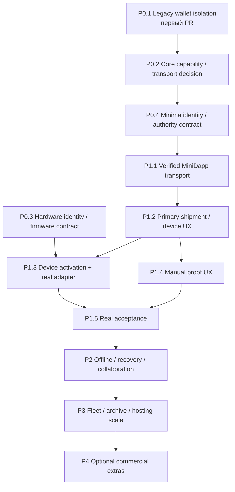

# Trackium: последовательная дорожная карта Minima-native продукта

Основание: [аудит `main` на `196b3dd`](DECENTRALIZED_ARCHITECTURE_AUDIT.md), 2026-11-08. **Этот PR содержит только документацию.** Все описанные изменения — будущие отдельные PR; действующие Gateway, PostgreSQL migrations, Railway settings, MiniDapp, Android и Proof Engine этим планом не изменяются. Номера будущих implementation PR намеренно не предсказываются.

## Цель и условия выпуска

Пользователь приобретает устройство, запускает поддержанный Core и MiniDapp, привязывает аппаратную идентичность, ведёт shipments и видит проверяемые доказательства. Основная работа не требует email, сайта SaaS или оплаты подписки. Self-hosted/customer-controlled Gateway остаётся допустимым и сначала необходимым компонентом; managed Railway — необязательный hosting того же протокола.

Нельзя объявлять этот сценарий готовым по наличию static demo, APK, healthy HTTP или mock publication. Текущий [MiniDapp client](../assets/v2/gateway-client.js) не имеет Core-origin transport; текущий [registry](../services/gateway/src/telemetry/service.js) не проверяет hardware ownership; [ingestion](../services/gateway/src/cargo/ingestion.js) принимает только synthetic adapters. Поэтому сначала закрываются trust/host gaps, затем добавляется UX, и только потом автономность и масштабирование.

Во всех этапах сохранять TLS, tenant isolation/FKs, неизменяемую историю, provenance, bounded requests, explicit wallet consent, durable checkpoint-before-post, duplicate/recovery protection и независимую verification. Биллинг не участвует в identity. Не переписывать существующие SQL 001–005: если отдельная будущая задача требует схемы, создавать additive migration с прежними checksum/lock guarantees. [Migration runner](../services/gateway/src/telemetry/migrate.js), [ownership coordinator](../services/gateway/src/proofs/ownership.js).

## Порядок PR и зависимости

Разрешены независимые read-only исследования P0.2/P0.3 после начала P0.1, но нельзя публиковать financial/physical trust claims до их gate. Любая Mainnet acceptance — отдельное действие оператора с явным разрешением, не CI и не автоматическая часть merge. Railway acceptance checklist можно заполнять наблюдениями, но audit/implementation PR не применяет настройки среды без отдельной задачи.

## P0 — безопасность и архитектурные блокеры

### P0.1 — изолировать legacy wallet path

**Первый конкретный PR:** `fix: isolate legacy wallet actions from Cargo MiniDapp`.

**Почему первым:** [`legacy.html`](../legacy.html) поставляется [packager-ом](../scripts/package-minidapp.py), загружает внешний script в контекст MDS, [`onMDSReady`](../assets/js/app.js) вызывает wallet-related initialization. [`submitProofOfMovement`](../assets/js/blockchain.js) имеет burn/float/fallback ID path вне новых safety gates, а [`dapp.conf`](../dapp.conf) сохраняет write trust. Это установленная кодовая поверхность, не подтверждённая эксплуатация. Перенос UI без её изоляции оставляет второй способ wallet mutation.

**Изменения в будущем PR:**

- Убрать privileged legacy financial controls/init/автопубликацию из активного Cargo release path; исключить исполняемый legacy wallet code из обычного пакета либо вынести в отдельный явно неподдерживаемый архив без автоматического запуска. Простого скрытия кнопки недостаточно, если commands остаются доступны из загруженных scripts.
- Сохранить существующие local SQL records и безопасное чтение/экспорт. Не удалять legacy devices/movements, не мигрировать старые `blockchain_proof` flags в «verified» и не вызывать wallet mutations для чтения истории.
- Устранить внешний JavaScript из privileged MiniDapp path; читать карты локально/схематично. Не ослаблять CSP и не загружать удалённый script ради карты.
- Проверить и описать permission split между read-only workspace и явным publisher. Не менять `trust` на READ вслепую, ломая поддержанный local publishing; выбрать поддержанную Core-модель и протестировать её.

**Зависимости:** текущий packager/MDS entrypoints; аппаратное устройство и Minima Mainnet не нужны. Существующие старые установки не исправляются автоматически новым пакетом: нужен ясный upgrade notice без удаления их данных.

**Готовность:** browser/VM tests при open/navigation/read/export фиксируют **ноль** `newscript`/`txn*`/`sign` calls; пакет не тянет внешние scripts; legacy read/export работает на старой schema; fallback custom transaction ID никогда не показывается как chain proof. Новый publisher по-прежнему требует свои gates. Всё проверяется mocks/local fixtures без финансовых команд на реальном Core.

**Размер:** один ограниченный security PR с packager/UI-entry isolation, regression tests и upgrade note. Не совмещать с новым transport или auth rewrite. После него — P0.2, а не billing.

### P0.2 — подтвердить Core host и безопасный transport

**PR:** `docs/test: define verified Core capabilities and MiniDapp transport boundary`.

**Изменения:** составить versioned capability manifest для выбранного classic MDS desktop/Android profile: MDS app identity/caller binding, storage visibility, callback errors/timeouts, WebCrypto/BigInt/Web Locks, HTTP header support и lifecycle. Зафиксировать BlackBear как отдельный Android IPC target до отдельной host-интеграции. Провести безопасный read-only spike на доступных реальных host-ах; явно оставить untested host неподдержанным, а не разрешать произвольную версию.

**Опора:** [MDS SDK](../mds.js), [MDS bridge](../assets/v2/mds-bridge.js), [classic publisher](../assets/v2/local-core.js), [BlackBear transport](../apps/android/app/src/main/java/tech/trackium/cargo/BlackBearTransport.kt). `MDS.keypair` — app key/value store, а не доказанный secret vault. `MDS.net.GETAUTH` не умеет произвольные Bearer/PoP headers. Наличие `MDS.api` ещё не доказывает verified caller identity.

**Зависимости/решение:** primary MiniDapp сначала на доказанном MDS-capable Core. Если обязательным host является BlackBear без MDS host, нужен отдельно согласованный host extension/интеграционный проект; Android WebView внутри собственного APK нельзя молча назвать готовым Minima MiniDapp. Если безопасный broker недоступен, P1.1 блокируется с конкретной причиной, а не обходится wildcard CORS/публичным proxy.

**Готовность:** ADR выбирает один primary host/transport и перечисляет реальные observations отдельно от source/mock findings; negative tests для wrong app/caller/origin, expired context и timeout; нет long-lived owner token в page/URL/JS-readable keypair, нет arbitrary RPC relay и скрытого privilege escalation. Read-only real-host observation возможна без wallet signatures/transfers. Публикация остаётся off.

**Разбиение:** один ADR/capability test PR; если нужен host change — отдельный PR/issue в соответствующем Core с собственным review, не неявная правка Trackium APK.

### P0.3 — аппаратная идентичность и ownership contract

**PR A:** `docs: specify tracker enrollment, ownership transfer and recovery`.

**Изменения:** запросить и изучить фактическую модель/firmware/протокол устройства, физический transport, buffers/retry/ACK, источник времени, защиту ключей, provisioning/manufacturing trust. Классифицировать, что реально можно доказать: authenticated sender ≠ подлинный GPS/температура ≠ физическая недоступность вскрытия. Текущий [raw LF framer](../services/gateway/src/framing.js) и [registry UUID](../services/gateway/src/telemetry/service.js) этого не реализуют.

Определить globally authenticated hardware identity отдельно от tenant-local UUID, activation challenge/expiry, защиту повторного enrollment, ownership epoch, смену владельца и revoke старых grants. QR/IMEI/password сами по себе не доказательство аппаратного владения. Certificate/challenge-response использовать только если подтверждены firmware/key protection/manufacturing keys; если нет, честно оставить provenance unverified и указать нужное изменение hardware/firmware.

Transfer должен требовать утверждённого авторизатора (например, согласие текущего владельца плюс новый PoP по проверенному протоколу), атомарно отзывать старый доступ и оставлять историю. Lost-owner/factory reset — явная политика, не неподписанное «я знаю serial» и не новый email account как master key. Не обещать готовый Maxima transport: в [legacy registry](../assets/js/device-registry.js) subscription/lookup незавершены.

**Готовность PR A:** заполненная capability/threat matrix и wire/test vectors; определены replay/cloning/transfer/recovery adversaries и уровень provenance. Если spec или hardware недоступны — зафиксирован release blocker; фиктивный mock не снимает его.

**PR B (только после A):** `feat: enforce authenticated tracker enrollment and ownership epochs` — минимальный server/firmware adapter с future additive schema, authenticated identity uniqueness, tenant binding, bounded activation и audit trail. Сохранить existing clients/tenants; не использовать native client random proof как tracker key.

**Готовность PR B:** negative tests для чужого tenant, replay, double claim, cloned identifier без key, transfer race, старого owner после transfer и recovery without authority; реальный hardware transcript отдельно от fixtures. Его отсутствие блокирует объявление «безопасно привязываем физическое устройство», но не мешает разработке UI с честными synthetic fixtures.

### P0.4 — Minima identity и финансовая authority

**PR:** `docs/test: bind Minima proof-of-possession to existing tenant authority` — сначала контракт/векторы, затем отдельная минимальная реализация после P0.2.

**Изменения:** разграничить owner identity, employee identity, client session, tracker key и Gateway job signer. Сохранить tenant IDs, scoped sessions и revocation; предусмотреть проверенную Minima PoP привязку к текущему tenant вместо второй базы глобальных SaaS accounts. Определить one-time challenge с domain/audience/expiry/nonce и явной approval semantics. Нельзя аутентифицировать remote owner по UID/getaddress response или подменять API credential публичным address.

В upstream classic Core `sign`/`verify` существуют, но [Wallet.signData](https://github.com/minima-global/Minima/blob/52542f25605a28a776e9b3b43b0808a05dceab01/src/org/minima/database/wallet/Wallet.java) расходует/persist-ит key uses; их нет в текущих [native](../apps/android/app/src/main/java/tech/trackium/cargo/BlackBearTransport.kt)/[RPC](../services/gateway/src/proofs/rpc.js) allowlists для login. Отдельно проверить разрешения/ключи/ответы точного host и возможность dedicated identity key; не предполагать готовый key-generation API. Wallet signature не должна выполняться на каждый poll. Session PoP и replay защита остаются на существующем scoped transport.

**Зависимости:** P0.2; recovery/membership semantics предварительно описаны, implementation углубляется в P2. Existing operator-owner approval остаётся безопасным development bootstrap, пока пользовательский путь не доказан.

**Готовность:** подписываемый payload однозначен, wrong audience/replay/foreign tenant/key substitution отвергаются, key rotation/revoke не теряют Cargo ownership; нет seed/private key export. Core namespace mutation race не «решается» JS locks: сохранить dedicated-wallet/trusted-app restrictions до reviewed host fix. В этом PR нельзя включать автоматический Mainnet или удалять Gateway checkpoint coordinator. [Текущие safeguards](../services/gateway/src/proofs/ownership.js), [границы Core](DECENTRALIZED_ARCHITECTURE_AUDIT.md#7-что-реально-доступно-через-minima-api).

## P1 — полноценный пользовательский сценарий MiniDapp

### P1.1 — authenticated Core-origin transport без ручного website handoff

**PR:** `feat: connect installed Cargo MiniDapp through the verified session transport`.

**Изменения:** внедрить выбранный в P0.2 host adapter в [`GatewayClient`](../assets/v2/gateway-client.js), сохранить existing Gateway session/scopes/revocation и approved origin allowlist. User-visible onboarding запускается из MiniDapp; secure authority bootstrap — по P0.4, а не owner-token textbox. Если нужен отдельный доверенный helper, он только transport/secret boundary, не новая бизнес-логика и не ещё один основной UI.

**Зависимости:** P0.2/P0.4; пока нет validated secret/caller isolation, выдача transport «на доверии» запрещена. Не копировать `android-native-v1` headers в JS ради обхода Origin checks и не превращать `MDS.net` Basic Auth в owner-token tunnel.

**Готовность:** установленный MiniDapp получает реальные tenant-scoped data через свой origin, а не открывает `/app/` как единственный рабочий путь; connect/revoke/expiry/outage тестируются, демо никогда не подставляется автоматически. Проверены desktop и заявленный Android MDS host отдельно; mock-only платформы остаются experimental. Wrong-caller/host/origin/replay negatives проходят, запросы ограничены.

**Разбиение:** один transport/boundary PR, затем небольшой onboarding UI PR. Gateway web остаётся secondary/support client; native APK работает по прежнему контракту. Без shadow rewrites API/Android.

### P1.2 — основной Cargo UX и ограниченное чтение

**PR A:** `feat: manage shipments and registered devices inside Cargo MiniDapp`.

**Изменения:** переиспользовать server view/domain contracts: create, draft edit, route/conditions, transitions, registry/read status, events, proofs, revoke. Добавить понятную edit-форму для существующего PATCH; нельзя редактировать active shipment в обход `update` restrictions или менять provenance устройства. Static Preview — отдельный явный режим. Убрать stale «not implemented/00 proofs» labels, если активный источник реально поддерживает данные. [Shipment API](../services/gateway/src/cargo/api.js), [service](../services/gateway/src/cargo/shipments.js), [раздельный UI](../assets/v2/server-workspace.js).

**PR B:** `perf: bound Cargo refresh and follow pagination cursors` — нужен уже для 10 устройств, не только для enterprise scale. Не загружать все device histories/details/proofs на каждом экране; lazy details, cursor pagination, bounded concurrency, backoff/Retry-After и согласованный refresh budget. Preserve existing rate/security limits. Статический конфликт `5+3S+3D` запросов и ingress limits разобран в [аудите](DECENTRALIZED_ARCHITECTURE_AUDIT.md#9-отказы-восстановление-и-единые-точки-отказа).

**Зависимости:** P1.1; P0.3 обязателен для physical enrollment, но synthetic/read-only UX можно тестировать отдельно.

**Готовность:** 1 и 10 устройств/shipments видимы полностью, cursor доступен для >25; UI не помечает registry `real` как verified, не сообщает blockchain confirmation по таймеру; errors/empty/loading/mobile/keyboard проверены. Offline UI показывает недоступность/доступный stale cache только по будущему P2 контракту. Нет бесконтрольного fan-out и повторного auth storm после expiry.

### P1.3 — activation и реальная телеметрия

**PR A:** `feat: activate and transfer a verified tracker from MiniDapp` — UI к принятому P0.3 ownership protocol; компания добавляет несколько устройств без email и operator paste. При неизвестном/неподдержанном firmware — явный отказ, не fake registration success.

**PR B:** `feat: ingest authenticated tracker telemetry through the reviewed adapter` — реализовать действительное binary framing/checksum/ACK/auth binding, replay/ordering/sequence/gap semantics, stable source event IDs и durable ACK только после выбранной commit boundary. Reuse ingestion/event derivation contracts, но не давать real packets пройти через fixture parser. Reconnect/retry device behavior и store-and-forward подтверждаются устройством, не выводятся из LF tests.

**Зависимости:** P0.3 A/B, P1.1/P1.2. Если аппаратная криптография не поддерживается, выпуск явно ограничивается authenticated transport/unverified physical readings; не повышать trust enum ради UI.

**Готовность:** actual device → authenticated tenant/device → durable normalized event → shipment history; два независимых tenants, replays/duplicates/unknown device/wrong key/oversized/tampered packets и network loss имеют проверенные outcomes. Captured fixtures обозначены как fixtures; real hardware transcript не содержит keys и хранится отдельно от публичных location/customer данных. Никаких Mainnet транзакций для проверки ingestion не требуется.

### P1.4 — понятный ручной proof без подмены телеметрии

**PR A:** `feat: request a proof for an immutable shipment event in MiniDapp` — UI выбирает сохранённое событие, показывает provenance/canonical digest, issuer/publisher/сеть, затраты/limits и статус. Убрать обязательную CLI/file choreography только через validated transport; сохранить signed job, durable checkpoint/ack и tenant authority. Не использовать legacy publisher.

**PR B:** `feat: add explicit user-asserted shipment snapshots` — отдельный versioned event/идемпотентный request contract, только если нужен proof вне существующих selected event classes. Snapshot ссылается на конкретный known head/cursor и не переименовывается в sensor evidence. Запрещены replacement telemetry, подмена recorded event_time/actor/device и silent change trust. Не менять historical canonical bytes/checksums.

**Зависимости:** P0.1/P0.2/P0.4, P1.1/P1.2; P1.3 нужен для честных physical-source claims. [Текущий approve принимает только event confirmation](../services/gateway/src/proofs/ownership.js), [TYPES/commitment](../services/gateway/src/proofs/commitment.js) задают совместимость.

**Готовность:** signed job связан с неизменённым исходным событием; tampering/foreign tenant/expired approval/changed head/replayed request отвергаются; synthetic/user assertion не становится verified sensor reading. Lost-signature/post replies и app/Core restart сохраняют ту же identity; нет нового spend для «починки» unknown outcome. Mock tests и локальные validating-node checks отделены от реального wallet acceptance. Реальный financial acceptance — только по отдельной инструкции/разрешению, не CI.

Автоматическая запись domain events может быть обычной функцией. Автоматическая **финансовая** Mainnet публикация требует отдельной explicit bounded policy и review; не включать auto backlog или бесконечный per-event publish для завершения P1.

### P1.5 — приёмка end-to-end на реальных компонентах

**PR:** `test/docs: record the Minima-native device acceptance matrix`.

**Изменения:** воспроизводимые сценарии и обезличенные результаты для actual desktop/Android MDS host, выбранной physical firmware, self-hosted Gateway и отдельного managed deployment. Проверить activation, shipment edit/monitor, reading/proof verification, revoke, phone/Core/Gateway restart, истечение session и отсутствие fallback в preview. BlackBear APK проверять как отдельный клиент, не как доказательство MDS hosting.

**Готовность:** каждый заявленный платформенный путь имеет actual device/host version, commit, safe transcript и ограничения; неподтверждённые paths не включены в supported matrix. Для Railway отдельно подтвердить deployed SHA, migration versions/checksums, приватную БД, число replicas, profile flags и backup test, используя авторизованный operator channel. Read-only health 200/401 из аудита этого не заменяет. Runtime settings не меняются автоматически из acceptance PR. [Исходный Railway checklist](RAILWAY_DEPLOYMENT.md).

## P2 — автономность, восстановление и совместная работа

### P2.1 — локальное чтение и управляемая offline очередь

**PR A:** `feat: add bounded offline Cargo read cache` — versioned local replica of authorized records, last known cursor/head, explicit stale/as-of status, tenant separation, supported at-rest protection и storage quota. Не считать localStorage/keypair secret vault и не показывать stale data как live confirmation. Пользователь знает, что offline revoke нельзя немедленно проверить: определить срок допустимого offline read и sensitivity policy, а не обещать мгновенный revoke без сети.

**PR B:** `feat: reconcile queued Cargo commands with idempotency and conflict checks` — только нефинансовые разрешённые команды, stable request IDs, expected revisions/head, expiry и серверная перепроверка authority при reconnect. Immutable event append вместо overwrite; conflict UI без last-writer-wins потери. Запрещены queued wallet signing/post и silent replay financial consent.

**Зависимости:** стабильные P1 domain/auth/transport contracts. Данные ещё принимаются Gateway; это не обещание, что cellular tracker сам доставляет на выключенный телефон. Device offline buffer/retry — отдельный контракт P1.3.

**Готовность:** offline/reconnect/reorder/replay/two clients/quota exhaustion tests не создают дубликаты, не смешивают tenants и не завышают provenance/confirmations; явно описано, какие новые данные недоступны без Gateway. Raw samples не считаются сохранёнными до durable boundary.

### P2.2 — backup, смена телефона, keys и outstanding proofs

**PR A:** `feat: export and restore verifiable Cargo archives` — journal/canonical bytes/proof bundles/schema versions, consistency/head checks, private payload encryption/access policy и restore в отдельный instance. Один chain digest не backup. Сохранять старые migration checksum history и соответствие commitments. Не удалять chain prefix ради retention без проверяемого archive/segment contract.

**PR B:** `feat: recover client authority and outstanding publication checkpoints` — новый client key/session и revoke старого, employee/owner rotation по принятому proof-of-authority/recovery policy, перенос public checkpoints/acks с сохранением идентичности. Android Keystore не переносится просто копированием ciphertext; при его утрате нужен контролируемый recovery. Старые wallet slots/limits/TxPoW IDs не сбрасывать. Core seed/key-use recovery — ответственность проверенного Core, не новая Trackium seed import функция.

**Зависимости:** P0 identity contract и P1, свежая независимая verification; для восстановления Gateway signer — отдельная pin rotation/old-key trust процедура.

**Готовность:** restore rehearsed без production data deletion; known submitted artifact восстанавливается как тот же artifact, unknown signature не вызывает re-sign, другой телефон не создаёт конкурирующий job; old sessions действительно отозваны online. Для replica/seed restore описан запрет одновременных wallet copies. [Текущая durability](../apps/android/app/src/main/java/tech/trackium/cargo/SecureStore.kt), [claims/checkpoints](../services/gateway/src/proofs/ownership.js).

### P2.3 — компания, сотрудники и конкурирующие изменения

**PR A:** `feat: delegate company access with scoped memberships` — human/app principal IDs отделены от company tenant, invite/accept PoP, reader/operator/publisher/owner roles, scope ceilings и при необходимости per-shipment/device grants. Существующие tenant/key IDs сохраняются, никакой обязательной email identity или общих owner credentials для сотрудников.

**PR B:** `feat: reject conflicting shipment edits and record authorized actors` — revision/ETag or expected-head preconditions, actor audit log, tenant-isolated conflict view; отдельный revoke сотрудника не блокирует остальных и не передаёт ownership устройства. Native read/publish session не получает shipment-write scope неявно.

**Готовность:** два сотрудника редактируют один draft → stale mutation отклоняется с понятным conflict, а не затирает чужое изменение; revoked actor не может renew/approve/delegate; reader не редактирует/публикует; losing owner и employee recovery разведены. DB-level serialization остаётся, но не выдаётся за resolution semantic conflicts. [Текущая serialization](../services/gateway/src/cargo/shared.js), [draft update](../services/gateway/src/cargo/shipments.js).

## P3 — флот, длинная история и дополнительные возможности

| Рекомендуемый PR | Изменения и зависимости | Критерии готовности |
| --- | --- | --- |
| `perf: validate fleet capacity at 1/10/100 devices` | После bounded reads/P2: representative telemetry rate, several employees, one Gateway/pg pool; capture DB contention, p95/error/drop/backlog/storage, не увеличивать ingress budgets до измерения | Повторяемая локальная/изолированная нагрузка без реальных devices/денег, documented hardware/rate и допустимые задержки; все 100 видны через pagination, изоляция и quotas не деградируют |
| `feat: add bounded aggregate/delta Cargo reads` | Только если P1 bounded/lazy reads недостаточны; aggregate/read model или versioned deltas вместо N+1, общий contract для MiniDapp/web/APK | Запросы и concurrency укладываются в budget, backpressure/reconnect/versioning/permission filtering протестированы; нет «всем tenants одним stream» |
| `feat: verify archived chain segments` | Убрать практический предел full prefix ≤2000 records/4 MiB через проверяемый segmented/archive contract, с совместимостью существующих proofs и external verifier | Старый full bundle верифицируется по-прежнему; missing/interchanged segment и wrong head обнаруживаются; нет перехода к доверию серверному boolean вместо проверки bytes. [Сейчас bundle limit](../services/gateway/src/proofs/service.js) |
| `feat: retain and back up telemetry under explicit policy` | Retention/quotas/monitoring, не удалять единственные payload bytes, нужные опубликованным commitments. Не использовать chain вместо cold storage | Предсказуемый disk budget, alert/restore drills, privacy/access controls; пользователь понимает срок хранения/экспорта, истечение quota не уничтожает identity |
| `feat: document managed/self-hosted portability and multi-instance ownership` | Только после load evidence: private-network failover/worker leadership и process-local limiter replacement, если действительно нужен scale-out | Нельзя масштабировать replicas без общих auth/rate budgets и wallet coordination; failure injection не создаёт повтор spend. Один инстанс остаётся supported simple default. [Текущий ingress](../services/gateway/src/ingress.js), [proof advisory lock](../services/gateway/src/proofs/service.js) |
| `feat: isolate company publication budgets and publisher authority` | Для managed multi-company отдельно проверить lifetime reservation semantics, per-company wallets/approvals и host-wide resource ceiling; текущий global cap 1 не становится billing entitlement | Исчерпанный бюджет одной компании не выдаёт другой её authority/данные; unknown jobs сохраняют reservations, старые rows не удаляются ради quota; native/local и opt-in server policies явно различены. [Текущий approve/policy](../services/gateway/src/proofs/ownership.js) |
| `feat: add explicitly bounded optional proof batching policy` | Опционально после P1 proof/recovery: event selection/coalescing, signed policy, lifetime/attempt/input limits, явное пользовательское согласие; оценить prior-event ordering и compatibility | Никакого automatic backlog/fund spend по умолчанию; сохранены provenance/inclusion/duplicate recovery. Нет обещания бесплатной сети без реального Core acceptance |

Maxima/P2P delivery и независимые Gateway federation — отдельные research задачи только при реальной потребности. Наличие `maxima action:send` в legacy не доказывает discovery, ACL, offline mailbox, delivery guarantees или multi-company ownership consensus. Не ставить новый P2P слой на критический путь первой полноценной MiniDapp.

## P4 — необязательная коммерция

**PR A:** `docs: define optional managed-service entitlements` — описать платные extras: hosted storage/retention/backup, advanced analytics/integrations, SLA, corporate operations. Определить бесплатный device-owner baseline и self-hosting/export path. Зафиксировать, что за инфраструктуру/PoW/coins всё равно кто-то платит; «бесплатно» не означает бессрочный бесплатный managed сервер.

**PR B (только по отдельной задаче):** `feat: enforce optional hosted entitlements independently of identity` — отдельная entitlement model, с mapping на существующую company identity; выбранный будущий billing provider не становится источником owner authority. За billing callbacks не должно следовать wallet signing, device transfer или remote key revocation.

**Зависимости:** P1 completed + P2 portability/recovery, измеренные P3 resource budgets. Сейчас ни billing, ни signup, ни subscription code не реализовывать.

**Готовность:** отключённый billing provider/истёкшая подписка не блокируют local MiniDapp baseline, владение hardware, чтение/экспорт собственной разрешённой истории и independent proof verification. Ограничения платного managed retention прозрачны заранее; есть безопасный export/переход на self-hosting. Тесты сравнивают identity/ACL и ownership до/после изменения entitlements; email/payment account необязателен для основы.

## Что не делать для сокращения срока

Не удалять Gateway/PostgreSQL ради названия «децентрализованно»; не переносить secrets в MDS JS; не принимать UID/public address как owner proof; не выдавать native pairing за hardware attestation; не считать synthetic телеметрию физической; не обходить TLS/CORS/CSRF/PoP или Core permissions; не сбрасывать proof claims/attempt counters после неясного исхода; не заменять независимый verifier таймером/NEWBLOCK; не включать Mainnet ради демонстрации; не строить billing раньше рабочего безаккаунтного owner scenario. [Подробные основания и ссылки на реализацию](DECENTRALIZED_ARCHITECTURE_AUDIT.md).

Следующее конкретное действие после принятия этого аудита — **отдельный P0.1 PR `fix: isolate legacy wallet actions from Cargo MiniDapp`** с regression tests и сохранением legacy data. Это уменьшает реальный privilege риск, не требует переписывания Gateway и не зависит от ещё не доказанных hardware/host capabilities.
