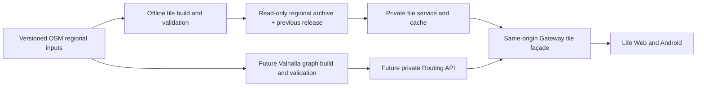

# Issue #88 A · Ukraine and Europe road coverage

**Review status, 25 November 2026 (Kyiv).** PR #92 now has an offline multi-country street prototype and a verified candidate vector source. A continuous Ukrainian/European street service has not been generated, benchmarked or deployed. Keep that distinction in product copy and in the release gate.

## Recommendation

Use **self-hosted regional vector archives, one tile service and separate Light/Dark styles** for continuous Ukraine + Europe coverage. Keep the existing bounded Leaflet raster path for the pilot and rollback. Switch the default renderer to MapLibre only after comparative acceptance on the target WebView, with the overlays and controls on the same API contracts. Plan for all of the available Ukrainian extract plus connected European regions. The pilot raster or a city spot-check cannot establish national completeness.

| Option | Coverage and resources | Client and operations |
| --- | --- | --- |
| Leaflet + pre-rendered raster XYZ | Any rendered area can reach street zoom. Two themes duplicate imagery. A high-zoom tree is expensive to build, store, refresh and cache. Regional or on-demand raster remains useful for pilots and low-end rollback | Mature in the current WebView, independently styled PNGs, request per tile, no WebGL. Labels are fixed in the image. Current Gateway supplies local and same-origin fallback |
| MapLibre + vector XYZ / PMTiles | Lower native zoom plus overzoom, one feature payload for both themes. Regional archive actual size depends on the schema, boundary and filtering | WebGL, GPU RAM, style/glyph/sprite assets and variable WebView capability. Better control over labels and feature density. Require measured first load, pan, rotation and failure tests before migration |
| Hybrid, independent tile service | Archive/snapshot behind a bounded private service such as Martin, edge cache and same-origin façade. Raster as a separate optional rendition. Commercial source could replace the archive after explicit rights and attribution review | Provider replacement within the basemap contract. Swap tile URLs, style metadata, licence and dataset revision together. Do not send telemetry, shipment IDs, proof data or arbitrary URLs to a provider. Valhalla builds a separate graph |

[MapLibre GL JS](https://maplibre.org/maplibre-gl-js/docs/) · [Martin tile server](https://maplibre.org/martin/) · [Protomaps archives](https://docs.protomaps.com/basemaps/downloads) · [Leaflet](https://leafletjs.com/reference.html)



Phase A implements the Gateway raster path, optional separate Dark dataset, archive probing and the offline prototype. The regional vector deployment in the diagram is the recommended next infrastructure verification. Its release unit should include versioned tiles, style/glyph/sprite assets and attribution. Use edge rate/size/time bounds and read-only upstream credentials. Keep geographic fallback on tile errors and the last validated release available. Monitor cache hits, non-200s, bytes and latency. Stage updates off the request path and validate before promotion. Bound cache freshness by dataset/version and use an atomic mount/alias switch.

## Data and licensing

| Candidate | Data, licence and availability | Cost, usage and caching |
| --- | --- | --- |
| Geofabrik + self-hosted renderer and routing | Geofabrik indexes whole Ukraine and Europe PBFs and replication updates. Latest redirects observed to `ukraine-261123` (0.886 GB) and `europe-261124` (35.54 GB), from HTTP metadata. OSM ODbL; publish visible linked attribution and meet derived-database obligations | Download/build/storage/serve costs are operator costs. No supplier request quota on a local archive. Rebuild a pinned regional release and record data timestamp, checksum and licence. Use XYZ as reviewed in the Gateway, and private Martin or equivalent for vector |
| Protomaps open build or own Planetiler extraction | Public PMTiles distribution supplies actual OSM roads in the sampled Ukrainian and European tiles. Basemap licensing and credit obligations apply to the chosen layers and style. Verify complete target extent and metadata during promotion | Download/extract offline and host own copy. Public build download is useful for review and distribution; runtime requests should go to the controlled mirror. No app credentials at a third-party server |
| MapTiler Cloud | Commercial service has plan-specific licence, attribution, usage counting and key restrictions. OSM-derived layers are a candidate in Ukraine; run country and mobile latency checks using an authorized account | Published Flex reference USD 30/month with 25k sessions and 500k API requests as plan allowances, plus overage. Verify which counter applies, allowed Gateway proxy use, caching/mirroring, per-session versus per-request accounting, allowed retention and overages in writing before choosing it |
| Stadia Maps | Commercial web/mobile service with provider and underlying dataset attribution, including OSM where applicable. Country completeness must be tested on target style | Published Starter reference USD 20/month for 1M credits and USD 0.03/1,000 extra credits. Credit weight depends on endpoint. Verify permitted Gateway key use and tile cache terms before integrating. No price or quota has been committed |

[Geofabrik Ukraine](https://download.geofabrik.de/europe/ukraine.html) · [Geofabrik Europe](https://download.geofabrik.de/europe.html) · [OSMF attribution](https://osmfoundation.org/wiki/Licence/Attribution_Guidelines) · [OSMF public tile policy](https://operations.osmfoundation.org/policies/tiles/) · [Protomaps licence](https://docs.protomaps.com/basemaps/attribution) · [MapTiler pricing](https://www.maptiler.com/cloud/pricing/) · [MapTiler cloud terms](https://www.maptiler.com/terms/cloud/) · [Stadia pricing](https://stadiamaps.com/pricing/) · [Stadia attribution](https://docs.stadiamaps.com/attribution/)

Commercial quotas and spend remain unapproved. A supplier’s free access or ability to issue a URL confers no right to proxy or mirror tiles. PR #92 makes zero provider requests during normal operation and introduces no paid dependency.

## Coverage matrix

The candidate source for every row is Protomaps build `20261124` from OpenStreetMap. **Vector** is the number of features actually decoded from the `roads` layer in one native z14 tile per location. The archive reports native max z15. **Raster 16–18** is a small street extract of the named place built and rendered in Chromium in both Light and Dark. **Probe only** means no corresponding city raster was rendered. Each row is sampled coverage. Country-wide acceptance and Valhalla routing are open for every row. This includes availability of updated data for all regions of Ukraine.

| Country | Site | z14 roads | Lite raster |
| --- | --- | ---: | --- |
| UA | Kyiv | 111 | Raster 16–18 |
| UA | Lviv | 362 | Raster 16–18 |
| UA | Odesa | 125 | Raster 16–18 |
| UA | Kharkiv | 160 | Raster 16–18 |
| UA | Dnipro | 97 | Raster 16–18 |
| UA | Burshtyn | 48 | Raster 16–18 |
| UA | Holohory | 10 | Raster 16–18 |
| UA/PL | Shehyni–Medyka | 31 | Raster 16–18 |
| DE | Berlin | 239 | Raster 16–18 |
| PL | Warsaw | 241 | Raster 16–18 |
| CZ | Brno | 243 | Raster 16–18 |
| SK | Bratislava | 362 | Probe only |
| RO | Bucharest | 261 | Raster 16–18 |
| HU | Budapest | 376 | Probe only |
| AT | Vienna | 486 | Probe only |
| FR | Paris | 559 | Raster 16–18 |
| IT | Milan | 578 | Probe only |
| ES | Madrid | 744 | Probe only |
| NL | Amsterdam | 624 | Probe only |
| BE | Brussels | 508 | Probe only |
| EE | Tallinn | 254 | Probe only |
| LV | Riga | 258 | Probe only |
| LT | Vilnius | 129 | Probe only |
| SI | Ljubljana | 582 | Probe only |
| HR | Zagreb | 260 | Probe only |
| BA | Sarajevo | 243 | Probe only |
| RS | Belgrade | 298 | Probe only |
| ME | Podgorica | 134 | Probe only |
| XK | Pristina | 371 | Probe only |
| AL | Tirana | 400 | Probe only |
| MK | Skopje | 296 | Probe only |
| BG | Sofia | 330 | Probe only |
| GR | Athens | 699 | Probe only |
| MD | Chișinău | 109 | Probe only |

[Raw vector spot-check report](lite-road-review/europe/archive-spots.json) · [Raster sample bounds, source dates, hashes and XYZ coordinates](../services/gateway/test/fixtures/road-tiles/europe-samples.json)

## Reproduce and review

```sh
python scripts/road-map-pilot.py /tmp/trackium-road-pilot
NODE_PATH=/path/to/playwright/node_modules node tests/minidapp/road-pilot.capture.cjs /tmp/trackium-road-pilot /tmp/road-shots
NODE_PATH=/path/to/playwright/node_modules node --test tests/minidapp/road-basemap.test.cjs
npm install --prefix /tmp/trackium-pmtiles-tool pmtiles@4.5.0 @mapbox/vector-tile@2.0.5 pbf@4.0.2
NODE_PATH=/tmp/trackium-pmtiles-tool/node_modules node scripts/probe-road-archive.mjs 20261124
```

The raster script needs Python 3, time-zone data, DejaVu Sans and Pillow 11+. It downloads a bounded set of small OSM map API extracts once and retains local raw files. To repeat an identical observation, retain the raw files at their original manifest hashes. For country-scale builds use curated PBF distributions. Only six small OSM-derived raster PNG fixtures and review images are added to the repository. Rendered imagery is a Produced Work from OSM data under ODbL terms. The fixture marker is synthetic.

Run a disposable local Gateway with the existing workspace/auth configuration. Set `LITE_ROAD_TILES_DIR=/tmp/trackium-road-pilot/light`, `LITE_ROAD_TILES_DARK_DIR=/tmp/trackium-road-pilot/dark`, `LITE_ROAD_TILES_MAX_ZOOM=18` and `LITE_ROAD_TILES_DATE` to the snapshot date. The pilot renders only the reported sample areas. Use the capture runner to pan between those test locations. Gateway permits the original Light XYZ URL and a separate `dark/` variant when a Dark mount is present. A Light-only installation retains its readable Light tiles in Dark UI. Shapes, overlays and controls continue following workspace theme. Missing or failed tiles reveal the geographic overview beneath them.

| View | Desktop · Light | Phone viewport · Dark |
| --- | --- | --- |
| Kyiv | [1440](lite-road-review/europe/kyiv-1440.webp) | [390](lite-road-review/europe/kyiv-390.webp) |
| Lviv | [1440](lite-road-review/europe/lviv-1440.webp) | [390](lite-road-review/europe/lviv-390.webp) |
| Odesa | [1440](lite-road-review/europe/odesa-1440.webp) | [390](lite-road-review/europe/odesa-390.webp) |
| Kharkiv | [1440](lite-road-review/europe/kharkiv-1440.webp) | [390](lite-road-review/europe/kharkiv-390.webp) |
| Dnipro | [1440](lite-road-review/europe/dnipro-1440.webp) | [390](lite-road-review/europe/dnipro-390.webp) |
| Burshtyn | [1440](lite-road-review/europe/burshtyn-1440.webp) | [390](lite-road-review/europe/burshtyn-390.webp) |
| Holohory area | [1440](lite-road-review/europe/rural-holohory-1440.webp) | [390](lite-road-review/europe/rural-holohory-390.webp) |
| Shehyni–Medyka | [1440](lite-road-review/europe/shehyni-medyka-1440.webp) | [390](lite-road-review/europe/shehyni-medyka-390.webp) |
| Warsaw | [1440](lite-road-review/europe/warsaw-1440.webp) | [390](lite-road-review/europe/warsaw-390.webp) |
| Berlin | [1440](lite-road-review/europe/berlin-1440.webp) | [390](lite-road-review/europe/berlin-390.webp) |
| Brno | [1440](lite-road-review/europe/brno-1440.webp) | [390](lite-road-review/europe/brno-390.webp) |
| Bucharest | [1440](lite-road-review/europe/bucharest-1440.webp) | [390](lite-road-review/europe/bucharest-390.webp) |
| Paris | [1440](lite-road-review/europe/paris-1440.webp) | [390](lite-road-review/europe/paris-390.webp) |

## Performance and costs

**Measured:** The Protomaps build is 139,733,387,110 bytes worldwide. The 34 road probes transferred 4,701,390 bytes in 55 bounded range requests. The original warm Gateway tile smoke returned 200/200 with concurrency eight, p95 17.4 ms on loopback. The 400-request local mixed test (13 sites, both styles, eight concurrent, every tenth request outside the fixture) returned 360 tiles and 40 expected 404s, with zero unexpected responses, 3.91 MB bodies and 16.8 ms p95. Kyiv desktop: 230 ms, 21 recorded requests, 103,534 bytes, 13.2 MiB JS heap and 2.25 MiB estimated decoded pixels. Throttled Kyiv handset viewport: 1042 ms, 12 requests, 50,874 bytes, 14.9 MiB JS heap and 1.5 MiB estimated decoded pixels. In the unmocked Kyiv cache check the resource transferred 16,414 bytes cold and 0 bytes on reuse. The two-width pilot metrics include transfer size, time from focus and zoom to the central street tile, page JS heap, and a decoded tile estimate from visible pixel dimensions. Chrome's throttled Kyiv case models 150 ms latency and 200 kB/s down. These are controlled browser measurements. The capture harness intercepts the fixture API and disables its context's HTTP cache. Separate unmocked cache measurements use a clean context. [Raw browser measurements](lite-road-review/europe/browser-metrics.jsonl)

**Calculated bounds:** A rectangular z18 raster envelope for Ukraine (22–41°E, 44–53°N) contains ~137 million tile slots. An illustrative Europe envelope (12°W–42°E, 36–72°N) contains ~1.92 billion slots. At 20 KiB per slot that is ~2.8 TB and ~39 TB respectively, one theme at one zoom before clipping/sparsity/caching. These bounds warn against prebuilding every high-zoom tile for both themes. They are not predicted output sizes. Two copies of the measured *world* vector archive use ~279.5 GB. At a reference object storage rate of USD 0.015/GB-month, storage alone is ~USD 4.20/month. At 1,000 daily sessions, 80 reads/session, 60 KiB per read and 30 days, traffic is ~147 GB/month before cache savings. At the reference Class B rate of USD 0.36/million the 2.4M reads would be ~USD 0.86, before free allowances, with one object read per client request. Actual PMTiles range amplification, provider limits, cache, outbound traffic, build compute, VM, support and observability affect total cost. The reference is a published price scenario, not an infrastructure commitment. [Cloudflare R2 reference rates](https://developers.cloudflare.com/r2/pricing/)

**Unknown:** Region archive size with the selected style, build CPU/RSS/time, CDN hit rates, p95 on mobile networks, GPU/renderer RSS, and WebView performance on real Android hardware. Before deployment, reserve input space for both snapshots (1.77 GB Ukraine or 71.1 GB Europe PBF alone) and separately budget scratch, output, rollback and routing graph storage after a representative build. Start measurement with an offline 4 vCPU/16 GiB Ukraine builder envelope, then size Europe from observed peak RSS and disk. Build Ukraine and connected Europe once, measure archive and graph sizes separately, verify extent by low/high-zoom samples stratified across cities, border corridors and rural tiles, and set traffic/storage ceilings. Compare Leaflet versus MapLibre with equivalent geometry and labels, 1,000/5,000 map objects, one slow-network session and offline fallback. Keep both styles' cold/warm metrics and use actual operator quotes. Continuous coverage and total operating cost remain acceptance gates.

## Routing boundary and physical validation

The Shehyni–Medyka OSM extract joins road references `28` and `М-11` at two shared nodes. In the undirected sampled trunk/major graph, all 52 sampled `М-11` nodes are reachable from the 71 sampled `28` nodes. This is topology evidence without turn, access or traffic semantics. The wider locality contains mapped truck-adjacent restrictions, including a 24 t road segment. Absence of tags is unknown, not clearance. War-related conditions, road closures, checkpoints, border queues and infrastructure availability require up-to-date authoritative sources. The map cannot guarantee that roads are safe or traversable.

Phase B must build a unified Valhalla graph from pinned intersecting or connected extracts and test edge IDs, restrictions and route failures on Kyiv–Lviv, Lviv–Rzeszów, Kyiv–Warsaw, Odesa–Bucharest, Berlin–Warsaw and Warsaw–Paris. Verify international corridors and designated crossings with active data, one-way restrictions, access, bridge inventory, and separate truck dimensions (weight, height, width and length). Test graph clipping and disconnected regions, truck exclusion and no car fallback under a truck label. The routing and tile engines must retain independent versions. Measured trajectories, planned routes and calculated geometry remain separate.

Physical Android checklist:

1. Start from an approved HTTPS staging or local test setup for the supported Android origin. Sign in with operator-provided credentials and verify tenant isolation.
2. At Kyiv and Warsaw, pan, zoom to street scale, switch themes including System, let polling complete, and inspect labels, attribution, controls, Back and rotation.
3. Test network throttling, lost connection, missing tiles and resume. Record time to first tile, HTTP count, renderer/JS memory and whether the viewport or dialog moved.
4. Compare device position, Gateway receipt and measurement age. Check that a device without packets has no marker. Release after the real-phone review and operator approval.

The browser screenshots are responsive Chromium views. Offline Android shell instrumentation covers shell behavior. Authenticated road rendering, accessibility and memory on a physical phone remain to be accepted.
