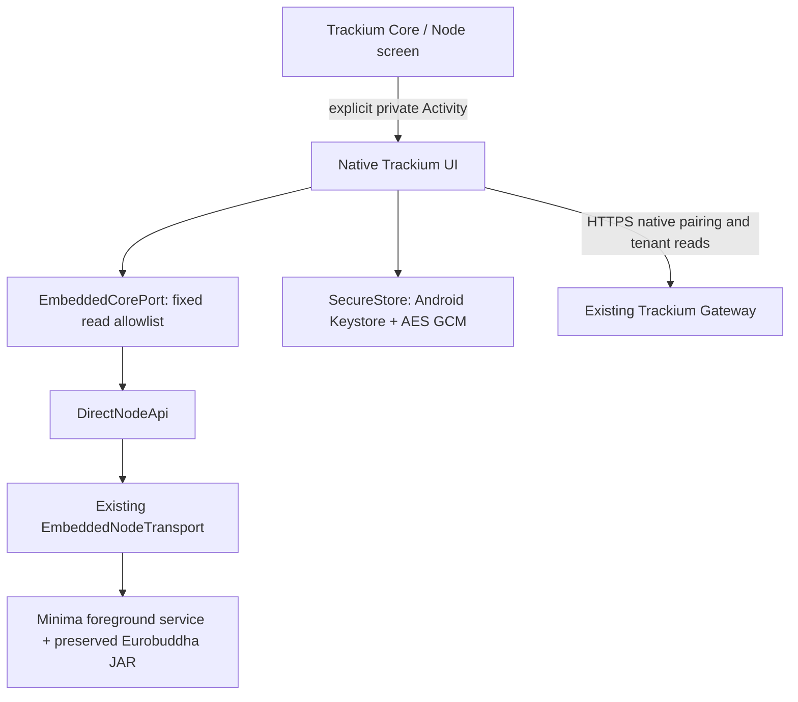

# Trackium Core prototype #1 architecture

## One application

`app` is the Eurobuddha BlackBear-derived host. Its Minima foreground service owns the existing `app/libs/minima.jar` and node databases. `integrated-trackium` is an Android **library**, containing the reused `tech.trackium.cargo` native UI, Gateway client, encrypted state and protocol code. It has no launcher, Application subclass, node service or separate APK. `integrated-history` remains the existing host utility tab. Pandamonium's other integrated DeFi applications are not imported.

This is Pandamonium-style **native library integration**, not an MDS MiniDapp, browser integration or companion-APK protocol. All code shares the host UID/process. The trusted-code allowlist is not a security sandbox against a malicious bundled library. The existing host Terminal/Wallet and internal transport retain their original privileged functions; only the Trackium capability is read-only.

## Startup and lifecycle

The `block` flavor retains `BLOCK_KEYUSES=true`, the upstream `StartupMode` argument generation (`-blockaskeyuses -lowram`), network/consensus parameters, key-use implementation, foreground service, startup/shutdown/restart controllers, backup/restore UI and app-lock. Only `blockDebug` is buildable; its distinct application ID is `tech.trackium.core.prototype`.

`MinimaApplication` installs `PandamoniumHooks.initialize`, which installs the unchanged `EmbeddedNodeTransport` backend into `DirectNodeApi`, events dispatch, and the host app-lock guard into `TrackiumCoreAccess`. The SDK's internal-host check explicitly permits this exact new package. Its standalone `MinimaAPI` constructor rejects the new host, preventing accidental external BlackBear pairing.

The main pager initially selects the existing Node screen (rather than Wallet). A native **Open Trackium** button and toolbar item launch an explicit, non-exported Trackium Activity. Closing it returns to the host. The foreground service owns the node independently of the Trackium Activity. Process restart reinstalls the backend and restores encrypted Trackium state from the new package's private storage.

## Node capability boundary

`EmbeddedCorePort` accepts only exact `status`, `balance`, `network`, `peers`, `block` strings. Parameters, batches, case variations, address allocation, signing, transaction/job publication, seed/backup/file actions and arbitrary terminal input are rejected before dispatch. Calls run off the main thread, time out after 15 seconds, require a foreground, unlocked Activity and reject responses after lock/pause/close. Upstream shared reads may already be executing when the Activity pauses; their observations are discarded, not represented as cancelled node executions.

The adapter advertises `admin=false`. Controller entry points for signed-job reservation, readiness-for-publication and publication additionally fail closed, regardless of stored safety switches. The original protocol/publisher code and regression tests are retained for future work but receive no write-capable transport. Opening Trackium only observes status. Even the wallet overview omits `getaddress`, which can allocate an address.

The host's opt-in PIN/biometric policy also guards Trackium before rendering cached data; locked entry shows only an unlock message. Activity lifecycle closes its adapter in the background. `FLAG_SECURE` and the host lock's secure-screen hook protect this Activity. This inherits the upstream app-open lock model: it is not encryption of the host seed at rest, and it does not stop the node while locked.

## Gateway and persistence

The existing native HTTPS client and owner-confirmed native pairing protocol are reused. No production URL, tenant credential or owner token is embedded; configuration starts empty. Gateway business reads remain scoped to the paired session/tenant. This change neither provisions a tenant nor changes server auth/API/environment. Live pairing, tenant isolation and real tracker ingestion require an operator-controlled test session and are not inferred from local tests.

Trackium settings, pairing/session state, cache and publisher checkpoints use the existing `SecureStore`: AES-256-GCM, atomic ciphertext in `noBackupFilesDir`, device-bound Android Keystore key. New application ID/UID means separate Keystore entries and data from both BlackBear and standalone Trackium despite reused alias strings. Android backup/data extraction exclusions remain enabled. No cross-app import/migration code is added. Explicit proof exports use a private `${applicationId}.trackium.exports` provider with scoped URI grants; tokens/seeds are not export data.

## Permissions and exposed components

The Trackium library adds **zero permissions**, a non-exported Activity and a non-exported export provider. No WebView, JS bridge, NodeTransportService, external package discovery or public command endpoint is added. Existing BlackBear permissions remain for the full node/host: Internet/network, foreground service, wake lock/boot/battery optimisation, notifications, camera/storage, audio and package visibility. They are broader than the Trackium library requires because the retained host also has wallet, backups, Apps and Chat features. No runtime camera/audio/storage permission is requested by Trackium itself.

The existing host launcher, boot receiver and signature/pinning-checked Android IPC endpoints are inherited, not made public by this integration. Existing SDK/host IPC regression suites are retained. No sharedUserId is declared; MinimaService and Trackium components stay private. Inspect the merged APK manifest rather than assuming library manifests alone describe all host permissions.

## Engine decision and acceptance boundary

The embedded Android engine remains byte-identical to Eurobuddha's `1.1.2.31-euro4` JAR. `sources.lock.json` pins its SHA256, and `preBuild` runs `verify-prototype.py` to prevent unnoticed replacement. The older identical Java source forks are comparison references, not replacement engines. See [engine and reuse review](REUSE_AND_ENGINE_REVIEW.md).

The prototype retains the ability of the original full node to communicate with Minima Mainnet, without changing consensus or cryptography. That compatibility is inherited source intent, not a new interoperability certification. Tests run disposable offline nodes, never import working wallets, sign, mine, spend or publish proofs. Manual host wallet actions are still privileged upstream functionality. Phone battery/background behaviour, Mainnet sync, backups/restoration and production spending remain unconfirmed and outside the prototype acceptance evidence.
